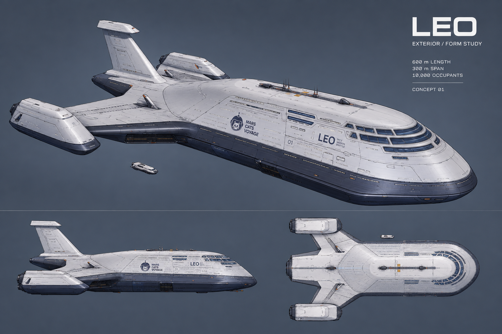

# LEO — Life aboard, interior study 01

**[Open the interactive website](https://leo.marscatsvoyage.com/)**. It is served by the Vercel project for leo.marscatsvoyage.com. The earlier `chatgpt.site` addresses are legacy and not the canonical site.

The next residential redesign is documented in [Residential hierarchy proposal](RESIDENTIAL_HIERARCHY.md): ten accommodation tiers, 5,214 rooms and 10,000 residents. This is a proposal; the current model retains its existing 5,000 twin cabins.



The image above is the current V35 perspective export from the live viewer, captured 2026-09-14. It replaces the older reference image that was previously easy to mistake for the current ship. The earlier concept is preserved as `src/reference-shuttle/assets/full-reference-concept.png`.

The accepted V31 exterior is retained as the source baseline. The active V36 exterior adds refined hull finishes, projected markings and seams, engine service panels and the glazed panoramic fin lounge. The current interior includes all ten furnished residential decks (5,000 twin cabins / 10,000 berths), ten fitted garden commons, 68 fitted ship areas across eight decks, and the shared observation lounge. Aft pass 03 now adds machinery, reservoirs, pod interiors, wing maintenance routes and fin structure and the panoramic crown to the combined ship GLB. The source `leo-exterior.glb` remains byte-identical; the viewer and combined GLB use the same refined V36 exterior. The machinery hall, tank bay and pod interiors now have removable enclosures, open portals and route lighting. Equipment remains a concept arrangement.

## Complete polish and directional glazing — V36

All 68 named rooms, nine service/command corridor groups, residential corridors, lifts, stairs, five aft sections, 5,000 cabins, ten gardens and both observation lounges share the second polish pass. It adds softened joinery, tailored upholstery seams, instrument bezels, satin hardware, stair edge markers and calibrated material finishes without moving established floors or routes.

The original curved white fin-cap underside is retained below the panoramic lounge, with a clear lift opening. The same underside is present in the exterior, full ship and standalone aft lounge. The small underfloor rim joins it to the lounge floor.

All 1,382 passenger windows and the bridge, observation and fin-crown glazing use opposed single-sided surfaces: exterior opacity 0.88 and interior opacity 0.12. This is an art-directed visualization treatment, not a physically reciprocal optical coating. The dual surfaces survive GLB export and remain tinted after changing viewer modes. Forward observation bands now have actual apertures through their previously opaque shell and seal backing. Existing window floor alignment is preserved; enclosed cabins away from the hull do not gain private exterior views.

`node scripts/check-polish.mjs` audits the saved complete ship, including every named area, both glazing faces, clear bow sightlines and the retained lower cap against the accepted source. Historical sections and renders below describe their labeled earlier passes.

## Engine maintenance windows — V35

Added 52 glazed exterior openings: 16 beside the central thruster hall and 36 across the side engine pods (nine on each inner and outer face). Matching apertures and framed glazing now pass through the interior acoustic walls. The central sills sit 1.25 m above the -11.7 m maintenance floor; pod sills sit 1.25 m above the -19.7 m floor. Openings avoid the main equipment support stations. Exhaust outlets remain unchanged.

There are now 1,382 small exterior windows, excluding the large bridge and crown panorama glazing. Interior glazing layers are not counted as extra exterior windows. Use **Engine windows** to inspect the new exterior details. Aft systems inspection views show the matching interior windows.

Saved-model checks pass for pod apertures, 13,744 retained pod surface samples, inner wall apertures and 3,324 unchanged exhaust vertices. Main hull and fin checks, 68,587 aft containment samples, aft access checks, full assembly checks and all nine GLBs pass. The refined exterior is 49.16 MiB, the aft component 12.01 MiB and complete ship 157.45 MiB.

Current V35 renders: [engine windows](renders/exterior-refined-enginewindows.png), [concept](renders/exterior-refined-concept.png), [pod interior](renders/interior-aft-pods-inside.png), [central interior](renders/interior-aft-drive-inside.png). Other renders retain their prior revision labels.

## Upper and aft windows — V34

This pass adds 282 glazed openings: 74 on Deck 20, 140 around aft access levels, 20 along the upper aft service gallery, and 48 beside fin inspection platforms. There are now 1,330 small windows, in addition to the existing bridge and crown panorama glazing. Exhaust housings remain unchanged. Fin windows avoid registry marks, access hatches and the part of the fin embedded in the main hull.

Window heights derive from the deck/platform schedule. The original passenger rows begin 1.25 m above the structural deck datum (about 0.95 m above its 0.3 m raised finished floor); new aft and fin sills are 1.25 m above their actual platform floors. These are perimeter openings, not a guarantee of a private view from every enclosed interior room.

Checks confirm 3,205 sampled main-hull aperture positions and 120 fin aperture positions are open through the shell, plus 26,660 retained hull positions and 9,921 retained fin positions. Hull and fin bounds are retained. The fitted assembly and all nine GLBs pass. The refined exterior is 48.66 MiB and the complete ship is 157.45 MiB.

Use **Aft windows** for the new close-up. Updated V34 renders show [aft windows](renders/exterior-refined-aftwindows.png), [concept](renders/exterior-refined-concept.png) and [side](renders/exterior-refined-side.png). Other renders retain their prior revision labels.

## Passenger windows and mission emblem — V33

Both sides now carry 524 small passenger windows each (1,048 total), aligned to Decks 6–19. The 3.1 × 0.95 m apertures start 1.25 m above each deck floor, with transparent blue glazing, thin frames and reveals. Apertures cut through the retained hull and overlapping lower thermal panels. Rows leave space for the main identity fields, upper glazing and access hatches. These are perimeter windows; this does not give every internal cabin a private exterior view.

The supplied transparent Mars Cats Voyage PNG is preserved in `assets/mars-cats-voyage-original.png`. Its alpha contours, including the helmet, antenna, cat, whiskers and star, are reproduced as conforming navy geometry on both sides. The old approximation is removed. Use **Windows & logo** for the new close-up camera.

V33 checks sample 2,620 positions across paired apertures, verify 17,599 hull positions outside the openings, retain hull bounds, and compare 80,828 wing/pod/fin vertices with zero movement. The full assembly and all nine GLBs pass their existing checks. Updated V33 renders cover concept, top, side and the window/logo close-up; other exterior images retain their V32 labels.

## Explore

Run `npm start`, then open http://127.0.0.1:4173/.

- **Exterior:** inspect eleven cameras with the studio backdrop and full surface details enabled by default. Shape only isolates the approved form. Save exterior PNG exports a clean 3200 × 2000 image.
- **Explode:** turn the dial in the exterior panel (or press Explode Leo) to take the ship apart in stages: the hull halves part and drop away with their wings and engine pods (the pod machinery rises out of each pod), the fin and crown bar lift off aft, and all twenty decks spread 16 m apart with their cabins, fitted rooms, gardens, lifts and aft machinery. The decks lift one after another, top first. The last 30 % of the dial fades the floors and corridors away and scatters every room and space in a ripple from the middle of each deck, down to each of the 5,000 cabins, so each stands on its own, coloured by use (homes, shared spaces, food and life support, medical and safety, cargo and transfer, command, engineering; the legend gives counts). Meanwhile the hull halves sink below the spread decks, so both sides show from the overview cameras, and the fin crown bar's roof and glazing lift off to reveal the bar. Hover a scattered room for its name and click it to open it in its own view; on a touch screen, tap to pin the label and tap Open. Ship / Hull / Decks / Rooms buttons jump between stages, and the dial eases onto a stage when released near one. Explode Leo orbits the camera slowly as it plays. A faint outline of the assembled hull stays in place throughout. Call-outs name the deck bands and major parts. Overview cameras frame the exploded ship; close-up cameras reassemble it. Links keep the amount, e.g. `?camera=boarding&explode=100`. Furniture too small to see at exploded distances is hidden until you zoom in. The arrangement is illustrative, not an assembly sequence.
- **Neighborhood:** choose any of the ten neighborhoods, then inspect its cabin or upper garden. Enter this space opens an eye-level view. Show walls & ceilings controls the enclosure. Observation opens the shared lounge; Walkthrough follows the established six-stop Neighborhood 10 route or the new eleven-stop residential / engineering / fin crown journey.
- **Ship areas:** choose a cargo, transfer, cultivation, life-support, medical or recreation room. Switch between Room overview and Eye-level view. Locate on deck shows its connected deck plan.
- **Deck layout:** residential decks contain furnished cabin instances. The six original service decks have eight principal rooms connected by an eight-metre central corridor and seven-metre branches. Command and engineering have additional fitted corridors. Decks 17–19 show the ten garden commons.
- **Connections:** choose the forward or aft core and any served deck. Inspect a three-deck overview, lift lobby or stair landing. The forward pair of lifts and stairs serves Decks 1–20; the aft pair serves Decks 1–19. Upper promenades link all ten gardens on three levels.
- **Aft systems:** inspect the combined cutaway, central machinery hall, lower tank bay, paired engine pods, service access fin structure or the panoramic crown and bar. Section overview shows the retained exterior as a translucent context shell; Inspection view moves inside. Open `?aft=overview&view=overview` for the full aft cutaway.
- Save interior PNG exports the current room or neighborhood. Hide panels clears the overlays. Room, neighborhood and deck links retain their selected view when reopened.

Example: http://127.0.0.1:4173/?district=3&space=garden&eye=1

The new journey is available in **Walkthrough → Choose a journey → Residential / engineering / fin crown**, or directly at `?walk=1&tour=aft&stop=0`. Play, pause, next, previous and individual stop buttons are available. Eleven guided stops use scene cuts for deck and lift transfers; this is not continuous simulated walking. `aft-journey.json` records the route.

## Walk around Leo

`walk.html` (linked as **Walk around Leo** from the viewer's welcome card and phone menu) puts you aboard as Cosmo, animated by Voyager's Reach's own figure code (`src/walk/vr`, copied from the game; see its README): the authored walk and jog, the reference sprint, take-off, air and landing, the turning lean, the tail spring, the idle, crouch, slide and crawl, the seated pose and the ten emotes. Leo adds a pose for lying in bed. You start in the Deck 2 arrival hall.

- **Controls (Voyager's Reach's):** WASD or the arrows move, Shift runs (12 m/s), Space jumps (hold for height, press again in the air), C crouches (a slide when running), X goes prone, B opens the emotes and 1–0 play them, drag (or move the locked pointer) to look, the wheel zooms, E sits, lies down, calls a lift or opens its panel, M opens Go to, N the ship map, V swaps first and third person. On touch screens the left thumb steers a joystick (push to the rim to run), the right drags to look, and there are buttons for jump (hold for height), crouch, emotes and use.
- **The whole fitted interior is walkable:** all twenty decks, the 5,000 furnished cabins, every fitted room and corridor, the garden commons, the forward lounge, the stairs and the aft machinery, the engine pods, the fin platforms and the crown lounge. The body is a floating capsule 2 m tall and 0.7 m wide that steps over anything under 0.4 m (Voyager's Reach's capsule), so any avatar up to 2 m fits everywhere.
- **Railings:** every open edge where a floor drops more than a metre (galleries, the garden ends, mezzanines, platforms, the pod chambers) has a 0.9 m railing unless something already guards it. Jump it to take the quick way down.
- **Windows:** the hull is opened behind the bridge, observation lounge and crown windows and the glass cleared, so Mars and the stars show through.
- **Lifts work:** the four main lifts (Decks 1–20 / 1–19), the aft service lift (Decks 4–17) and the crown lift (service gallery, six fin platforms, crown lounge). Call a car at the landing, step in, choose a stop; the doors slide and the car carries you. Once called, the landing's call light stays lit and the prompt follows the car ("Lift coming · Deck 14") until it arrives.
- **Signs:** every lift landing has a deck plaque and a display of where the car is (with its direction while it moves), and every main stair landing a Stairs sign with its deck.
- **Seats and beds:** every chair, sofa, bench, stool, banquette, floor cushion and lifeboat seat can be sat on (benches offer a seat every 0.65 m) and every berth and ward bed lain in, cabins included.
- **Maps:** a mini-map in the corner turns with you; tap it (or press N) for the full plan of any deck, with its rooms named, the lifts and railings marked and the Go to places one tap away.
- **Go to** jumps to fourteen named places.

How it is built (`src/walk`): `world.js` builds every deck with the cutaway walls and ceilings back on; `collision.js` turns solid meshes into deck-band BVHs (three-mesh-bvh; rounded boxes collide as boxes, signs and dressing don't collide) and tests the repeated cabins through their instance transforms; `render-bake.js` merges the ~50,000 interior meshes into chunks by deck band, 40 m stretch and finish, and draws only the bands around you; `lift-ride.js` runs the cars and doors; `signs.js` paints the deck plaques, stair signs and car displays and mounts them on whichever wall a ray from the lobby finds; `rest.js` finds seat and bed spots. Faces that different build passes laid exactly on top of each other (a lobby floor on the transit floor, a partition on a room wall) would flicker once merged, so the bake nudges the smaller one out by 2 mm. The camera stops at 150 m; past that, `haze.js` draws a plain proxy of the hull (each deck's plate outline) in the fog's colour, so the far end of a long corridor fades into haze instead of showing space as if through a window. Four things are planned at build time by `scripts/walk-plan.mjs` and shipped with the page: `partitions.js` raises lined walls wherever a designed floor meets the bare deck plate (rising through a tall room's full height, and never across a window); `railings.js` finds the open drops; `windows.js` works out which pieces of the hull envelope lie under glass; and `deck-map.js` draws each deck's plan into one small image (`minimap.js` shows it). The exterior's wings, engines and seams are hidden and don't collide inside: the wing roots pass through the hull.

`npm run check:walk` (about ten minutes) floods the ship as the 2 m walker from the arrival hall, riding every lift and falling off every unguarded edge, and checks that every room, cabin, lift landing, seat and bed is reachable, that no fall leaves the ship and that nothing walkable is open to space; it writes `walk-report.json`.

### Walking together: Leo live

With a Leo live server, everyone on the walk page is aboard the same shuttle: other visitors walk, run, jump, crouch, emote, sit and lie down as Cosmo, with their names over their heads, and the lifts are shared (a car someone calls comes for everyone, and a call made while it is busy waits its turn). The top bar says how many are aboard; tap it to set your name, which you can also type on the loading card. Without a server the page is solo, as before, and if the server goes away it carries on alone and keeps trying to rejoin.

- **Server:** `server/leo-live.mjs` (`npm run live`), a small Node + `ws` process modelled on Voyager's Reach's authority. One process is one shuttle. It passes poses on (every flush to visitors on the same or the next deck within 64 m, twice a second to the rest; a still pose every 2 s), runs the lifts with the page's own lift code (`src/walk/lift-motion.js`) and tells everyone when a car's plans change. Settings: `PORT` (8090), `LEO_LIVE_MAX` (150 aboard), `LEO_LIVE_ORIGINS` (pages allowed to connect; `https://leo.marscatsvoyage.com` and localhost by default). The websocket is at `/live`, a health check at `/health`.
- **Wire:** `src/walk/net/wire.js`. The page sends JSON poses ten times a second; the server sends poses as bytes, about 14 per walking pose, with each visitor's id and name sent once (Reach's design, cut to what a walk needs). Visitors are anonymous: the browser keeps a random key and the server derives the visitor's id from it (Reach's scheme). Movement is trusted from the page; the server checks that poses are well formed and inside the ship, and limits how often anyone sends.
- **Page:** `src/walk/net/live.js` (the link), `src/walk/remotes.js` (others as Cosmo, eased as Reach eases its remote players; full bodies for the nearest 24 on the decks being drawn; names hidden behind walls).
- **Hosting:** on the PC that hosts Voyager's Reach, through Reach's Cloudflare tunnel, at `https://leo-live.marscatsvoyage.com`. `scripts/setup-live-host.ps1`, run once on that PC from a leo-threejs checkout on main (after `npm ci`), registers the scheduled task `LeoLive` (the server on :8090, started at logon and every minute, so a crash is back within a minute; log in `leo-live.log` beside the checkout), adds `leo-live.marscatsvoyage.com` to the tunnel's routes while keeping Reach's, points that one DNS name at the tunnel and checks `/health` from outside. To update the server there: `git pull`, `npm ci`, then `Stop-ScheduledTask LeoLive; Start-ScheduledTask LeoLive`. Reach's own `setup-permanent-link.ps1` sets the tunnel's routes to Reach's alone: if it is run again, run `setup-live-host.ps1` again after it.
- **Turning it on:** build with `LEO_LIVE_URL=wss://leo-live.marscatsvoyage.com/live npm run build:public` and deploy. A page can also be pointed at a server on localhost or a marscatsvoyage.com host with `?live=ws://localhost:8090/live`.

**Who is walking (Discord, through The Creamery).** The walk page asks, on its loading card, to connect Discord, with "Skip for now" (asked again after a week); the 3D viewer asks nothing. Connecting goes through The Creamery (creamery.marscatsvoyage.com), which already holds each member's Discord account and verified wallets, and comes back with a signed ten-minute **Leo pass** (EdDSA JWT: Discord id, username, display name, avatar, verified wallets). Someone already signed in at The Creamery is recognised without being asked. The page hands the pass to Leo live in its hello; the server verifies it against The Creamery's published keys (`/.well-known/leo-pass-keys.json`: signature, key id, algorithm, issuer, audience, expiry) and the visitor's name aboard becomes their Discord name, with a teal dot so others know it's really them. One body per Discord account. A tester's invite link (`?invite=CODE`, the same code that turns on tester feedback) always asks, and when that tester connects, Leo live logs which code was used by which Discord account and wallets (proper invite records will live beside The Creamery's members). Code: `src/walk/net/connect.js` (the page), `src/walk/net/pass.js` (reading and verifying passes), the hello in `server/leo-live.mjs`. Settings: `LEO_CREAMERY_URL` at build time; `LEO_PASS_JWKS_URL` and `LEO_PASS_ISS` for the server (both default to The Creamery's production). Pages served from localhost can use a local stand-in with `?creamery=http://localhost:<port>`.

**Testers wear the captain's hat.** Anyone whose browser holds a tester invite (the `?invite=` code that turns on tester feedback) walks in the revision 6 captain's hat, parented to Cosmo's head and fitted to the rig, and others aboard see it on them. See `src/vendor/captain-hat/README.md` for the fit, how it was checked against the head through every movement and emote, and its two adjustments (the tail on all fours, and the hat coming off when lying down).

`npm run check:live` runs the server against scripted visitors: the wire, joining and leaving, near and far rates, names, the shared lifts, a second tab, bad input, the cap, and sixty visitors at once (about 5 KB/s to each).

## Modeled spaces

Each neighborhood has 500 cabins with two beds, a desk, shelves, storage and a compact ensuite, arranged along five residential corridors. Cabin geometry is instanced across all 5,000 locations. The upper gardens contain planting, seating, café tables, shared kitchen and laundry facilities, parcel lockers, reading areas, two gallery levels with three-sided walkways and stairs. Gardens 3 and 4 sit 2.5 m closer to the centerline to clear a local narrowing in the pressure envelope.

The original 48 service rooms cover cargo and provisions; passenger arrival, screening, baggage and airlock preparation; hydroponics and food preparation; air, water, thermal, recycling and power distribution; medical care and emergency shelter; learning, library, exercise, recreation, theater, childcare, dining and community work. Medical wards now have 24 modeled beds each, and the airlock rooms contain enclosed chambers with stowed pressure-door leaves. These are concept arrangements, not capacity-rated ship systems.

The command deck now includes a bridge aligned with the upper bow windows, navigation, mission control, communications, crew facilities, briefing, data processing, a captain’s office and security operations. Five aft engineering areas contain concept power modules, drive-feed pumps, control stations, workshops and an engine-service gallery. The forward shuttle bay contains four transfer shuttles and raised boarding platforms. Five lower decks each carry twenty modeled 100-seat lifeboats, for 100 craft and 10,000 physical seat positions. Seat layouts preserve central and cross boarding aisles; endurance and evacuation rates are not rated.

The observation lounge retains 72 upholstered chairs, reading benches, tables and lamps, timber ceiling ribs, planting and a viewing scope. Its 24 m approach ramp rises 2 m from the garden level. The Mars backdrop is procedural illustration. Artificial gravity is assumed.

The aft blockout includes three central drive trains aligned with the three rear panels over Deck 8, four reservoirs over Deck 4, four drive chambers across the two engine pods, structural frames and basic supply connections. A dedicated service lift and switchback stair connect Decks 4–17. Stepped wing galleries descend from Deck 9 to the pod maintenance aisles. The fin contains spars, diagonal webs and seven inspection platforms served by a new passenger lift from the upper service gallery to the crown. The crown sits at 132.3 m, following the original cap footprint, with 66 panoramic window panels, a central island bar, eight bar stools and eight curved banquette groups. The roof lifts out in the section overview. Timber ceiling ribs, an oval pendant, low bar lighting and a sheltered lift lobby refine the arrival and gathering spaces. Equipment is fitted to the saved hull geometry; operating machinery and lift travel are not simulated.

## Model files

All models use ship coordinates and metres.

- `leo-residential-decks.glb`: all 5,000 furnished cabins and their residential corridors, across ten decks.
- `leo-garden-commons.glb`: ten furnished gardens with galleries and shared facilities.
- `leo-service-areas.glb`: all 68 fitted areas, including command, engineering, the four-shuttle bay and 100 lifeboats, plus horizontal corridor networks.
- `leo-neighborhood.glb`: the original integrated Neighborhood 10 study, including the same forward lift/stair geometry used in the whole ship, garden, ramp and observation lounge.
- `leo-full-ship.glb`: 157.45 MiB combined assembly: retained exterior, twenty cut structural decks, cabins, gardens, ship areas, observation lounge and the new aft blockout. Four main lift shafts and stair towers, one aft service lift and stair, and one crown passenger lift make six lifts and five stair towers. Coarse reservation boxes are excluded.
- `leo-aft-systems.glb`: 12.01 MiB aft model, including the five existing engineering rooms and their Deck 7 corridor.
- `aft-areas.json`, `aft-fit-report.json`, `aft-integration-report.json`: inspection views, shell containment checks and maintenance-route checks.
- `leo-transit.glb`: four lift shafts, four stair towers, landings and upper promenade connections.
- `assembly-manifest.json`, `assembly-roundtrip.json`, `transit-fit-report.json`, `transit-network.json`: assembly counts, integration checks and connection graph.
- `leo-exterior.glb`: unchanged accepted V31 source exterior.
- `leo-exterior-refined.glb`: 31.53 MiB active V35 exterior, including the panoramic crown; shared by the viewer and full assembly.
- `exterior-refinement-report.json`, `exterior-finish-check.json`, `EXTERIOR_REFINEMENT.md`: surface projection, retained-shape checks and visual review record.
- `ship-areas.json`, `cabin-schedule.csv`, `design-data.json`: area, cabin and deck schedules.
- `area-fit-report.json`, `special-area-fit-report.json`, `area-roundtrip.json`, `residential-fit-report.json`, `garden-fit-report.json`, `interior-fit-report.json`, `glb-validation.json`: validation evidence and scope.

Residential GLBs use `EXT_mesh_gpu_instancing`; import them with an application that supports that extension. The viewer uses the same detailed geometry.

## Integration and verification

Structural floors have openings for the lift shafts, stair flights and half-landings, the double-height hangar, garden atriums and observation lounge. Bow floor edges are clipped inside the finished exterior. The two aft Deck 16 rooms have recessed corners around the stair lobbies. Transit finishes sit 6 mm below adjoining corridor finishes where they overlap, avoiding coplanar flicker.

The combined GLB was reloaded and checked for 5,000 actual cabin floors, ten gardens, 68 area roots, four shuttles, 100 lifeboats, 10,000 lifeboat-seat instances and a single shared lounge. Checks cover 476,040 structural slab vertices, 1,850 main stair headroom positions, 294 landing/garden passage segments and 5,922 supporting floor samples. New aft checks cover 66,243 geometry samples against the saved hull, wing, pod and fin envelopes; 4,144 headroom and supporting-floor positions; and 18 horizontal clearance probes at the pod junctions. All nine GLBs report zero validator errors and warnings; instancing is additionally checked after loading because the validator does not support that extension.

The preceding V32 exterior check compared 544,384 primary hull, wing, pod and existing fin vertices against the retained baseline with zero movement. All 175,348 projected detail vertices resolve onto the hull. Eight exterior views were reviewed and exported: concept, perspective, top, side, front, aft, bow and engine.

This is a furnished main-ship **concept model** with aft machinery and a fin crown lounge, with artificial gravity assumed. System sizing, propulsion, life-support endurance, structural loads and evacuation flow are further engineering work. Lift cars are shown parked, and the guided camera route remains illustrative rather than a collision-navigation simulation.

## Rebuild

The complete interior refinement pass covers all 68 scheduled areas, nine service
and command corridor groups, the main lift/stair network and all five aft
engineering sections. Treatments include clinical furnishings and patient services,
cultivation rack details, cargo and storage identification, fitted workstations,
public-room upholstery, command displays, shuttle and lifeboat fittings, machinery
instruments, pipe bands, deck signage and stair grip strips. These are concept
details, not simulated operating controls. The earlier cabin, garden and lounge
finishes are retained. `refinement-coverage.json` audits the saved full-ship model.

Both observation lounges now share warmer upholstery, stone tables and refined
furniture details. The forward lounge has open reading shelves, layered planting
and timber wall lining. The fin crown retains its panoramic glazing and central
bar, adding oak battens, backed stools, table lamps and fitted service equipment.
The accepted room outlines, window geometry and main circulation remain in place.

Garden commons now share a refined finish template: layered foliage in the two
existing planted beds, cushioned oak benches, stone cafe tables and worktops,
coffee equipment, open reading shelves, warm pendants and under-gallery lighting.
All ten gardens retain their accepted footprints, galleries and routes.

The current residential finish pass adds rounded furniture, sage upholstered headboards,
oak storage, reading lights, desk lighting, ensuite accessories and corridor guides.
It repeats through all 5,000 cabins without changing their footprints or berths.
The aft dorsal sensor pad and its antenna move 49.24 m toward the nose, onto the
short crown. The accepted hull remains unchanged.

The public viewer is built with `npm run build:public` after the model build.
`dist/` contains the complete viewer and losslessly compressed model downloads;
each transport part is at most 16 MiB. The browser restores the original GLBs.
Local overlay/comparison tools are excluded from the public page. The live site,
leo.marscatsvoyage.com, is the Vercel project that serves `dist/`; its `vercel.json`
(cache headers) lives with that Vercel project, not in this repository.

```sh
npm ci
npm run build
npm run check
npm start
```

The crown geometry is derived from the projected cap outline. Only the solid cap, top marker and fin tip above the new floor are changed in the active exterior. Main hull, wings and engine pods retain the accepted shape.

The build retains `output/leo-interior-v01/leo-exterior.glb` and verifies its accepted SHA-256 before and after assembly. It first builds the refined exterior, then all fitted components, the assembly and the viewer. The legacy `scripts/build.mjs` is an exterior/planning generator and is not used by this workflow. Geometry uses +X forward, +Y up and +Z starboard. The exterior mapping is `physicalX = 0.94 * logicalX - 18`. V31 sources are preserved in `archive/v31-source`. Three.js is MIT licensed; its license is included in the output.


## Hydro-Nip Lounge — Neighborhood 1 garden commons, Deck 17

Neighborhood 1's garden commons is now the Hydro-Nip Lounge, a catnip lounge. Lounge concept by Tochtli (Discord tochtli_13), from a render by their designer, used for layout and mood only. It has the Anti-Gravity Geodesic Hammock Dome, the Haze Maze glass tower, the Terpene Tasting Deck, the Cosmic Munchies Converger, lounge seating, cat trees, hanging catnip and string lights. The galleries, stairs and shared services are unchanged, and the other nine commons stay gardens. Phase 1 is dressing: the dome and maze are sealed glass, and the stools, beanbags and cushions can be sat on in the walk. Source: `src/hydro-nip-lounge.js`; decisions and coordinates: `HYDRO_NIP_LOUNGE.md`.

## Residential nose commons — Decks 6–15

Ten fitted social spaces occupy the bow ahead of the residential decks. Each uses a hull-limited footprint at ceiling height, a 6 m central promenade and a 4 m approach from the forward core. No sleeping capacity was added.

| Deck | Commons | Defining activity |
|---|---|---|
| 6 | The Daily Grind | Cafe counter, conversation groups and small tables |
| 7 | The Reading Room | Book aisles and reading desks |
| 8 | The Colour Works | Shared studio benches and easels |
| 9 | Little Orbits | Soft play and child-height craft tables |
| 10 | The Listening Room | Piano, mixing desks and listening salons |
| 11 | The Games Club | Chess, board games and table tennis |
| 12 | The Slow Room | Stretching, meditation and tea |
| 13 | The Tinker Room | Electronics, printers and repair benches |
| 14 | The Long Table | Teaching kitchen islands and shared dining |
| 15 | The Quiet Grove | Low planting, seating circles and botanical study |

Open `?district=1&space=nose` or use Neighborhood → Nose commons. The selector preserves nose focus across all ten decks; Enter this space restores the lining at eye level. Both `leo-residential-decks.glb` and `leo-full-ship.glb` include all ten commons; the Neighborhood 10 download includes its grove. The existing upper garden commons remain separate. Geometry and route checks are in `scripts/check-nose-commons.mjs`. These are fitted concept interiors, not an occupancy or engineering certification.


## Aft neighborhood services — Decks 14–15

Four fitted rooms occupy x = −261 to −181 m, with 4 m doorways onto an 8 m central passage. The passage meets the existing aft landing at x = −174 m, leaving the service lift and stairs clear. Deck 14 contains laundry/linen exchange and parcel collection/returns. Deck 15 contains a repair studio and a shared-equipment/storage library. These are included in Ship areas, Deck layout, the service-areas download and complete fitted ship. Select an area for an eye-level view or locate it on its deck. The upper engineering gallery and fin access retain their existing geometry.


## Upper aft commons — Decks 16–17

Deck 16 adds Voyage training & briefing on the port side; Deck 17 adds the Fin lift arrival lounge on starboard. Both have 48 × 16 m footprints at x = −233 to −185 m and 4 m entries. Deck 16 has a new connection to the aft landing. Deck 17 reuses the existing upper gallery, with a single opening in its starboard railing leading through a protected connector to the lounge. The fin lift remains at its existing location. The rooms are available through Ship areas, Deck layout, Aft systems, and the service, aft and full-ship downloads.


## Lower bow facilities — Decks 1, 4 and 5

The lower nose now contains expedition stores/outfitting on Deck 1, fresh-food cultivation and preparation on Deck 4, and rehabilitation/movement on Deck 5. Each 64 × 60 m room lies at x = 164–228 m with a 6 m main room aisle. A 4 m approach connects it to the forward core; enclosing walls begin at x = 148 m beyond the stair towers. Decks 2–3 retain the double-height shuttle bay. The three areas appear in Ship areas, Deck layout and the service/full-ship downloads. Layout and equipment are concepts; throughput and clinical provision are not certified.


## Forward voyage forum — Deck 16

A 52 × 48 m forum at x = 154–206 m adds 120 modeled audience seats in two banks, four open mobility-device spaces, a rear foyer, side gathering tables and a 0.25 m stage. The stage ramp has a 5 m run and 2 m clear width. The room owns its 4 m approach from the forward core; walls begin beyond the stair towers at x = 148 m. The forum is available in Ship areas and Deck layout and is included in the service and complete-ship downloads. Modeled seating is not a certified event capacity.

## Lower aft services — Decks 1–3

Three rooms step back progressively beneath the rising tail: Deck 1 spares and bulk stores (44 × 30 m), Deck 2 maintenance workshop (60 × 36 m), and Deck 3 engineering support and inspection (71 × 38 m). Their forward entries at x = −154 m connect to the existing service spine at x = −148 m through 6 m wide approaches. Central and transverse aisles remain clear of racks, benches and inspection equipment. All three appear in Ship areas, Deck layout and the service/full-ship downloads. The lower tail beyond these rooms remains structural space where the hull does not permit full-height rooms. Geometry and saved circulation checks are in `scripts/check-lower-aft.mjs`.

## Deck 20 command finish

Deck 20 now has 11 fitted rooms: the nine existing command spaces and bridge, plus an aft mission-planning studio and crew-recovery lounge. The new 52 x 20 m rooms occupy x = -116 to -64 m, beside an 8 m spine that meets the existing corridor at x = -52 m. Full-height spaces stop before the roof drops below usable height farther aft. Fit checks use the final sculpted roof, rather than the earlier conservative upper hull profile.

Slate floors, blue upholstery, warm joinery, instrument details, planning-table surfaces and room signs carry through the command rooms. The main corridor has continuous inset guidance strips. The existing crew ready-room counter is moved aside to clear its entry. The accepted exterior and 10,000 modeled berths are retained. `scripts/check-command-deck.mjs` checks all Deck 20 finishes, roof containment, the connecting spine and room entries in the saved model.
