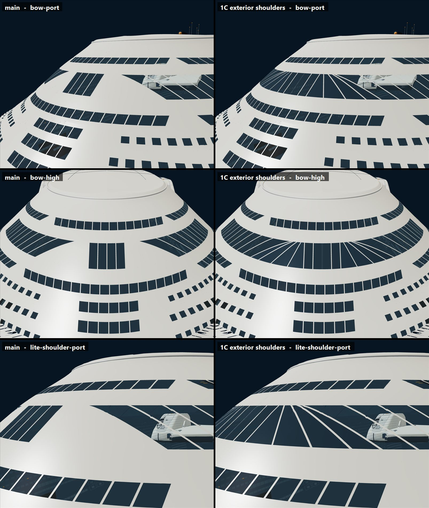

# 1C exterior shoulders

The walk interior's wraparound lounge windscreen (1C, #342) now shows from outside. Before this, the two shoulder
bands between the nose row and the side rows read as white hull on every exterior LOD.

*Left: main. Right: this branch. Exterior viewer (`layout2.html?view=exterior`); the bottom row is the phone/lite LOD.*

## How

`exteriorShoulderGlazing()` in `src/v2/lounge-shoulders(.authoring).js` runs in `scripts/exterior-envelopes-v2.mjs`
after `mergePressure()` for the web and phone exteriors. It:

- clips copies of the finished `Smooth_pressure_envelope_*` triangles to the same pane prisms the walk glazes (the
  8 shoulder panes and the centre pier), so the outlines and mullions match the interior panes;
- pushes each vertex 2.5 cm out along the interpolated skin normal (inside the 5 cm clearance allowance);
- names the mesh `V2_lounge_shoulder_exterior_glazing` (web 7,411 triangles, phone 1,519).

The overlay is **not finished skin** and **not `hullEnvelopeBatch` glass**:

- the skin authority, the raw web-skin proof and the window coverage are unchanged;
- the web layer passes the 5 cm skin-clearance audit;
- the phone layer, which sits on the +5 cm phone skin, is audited against the phone skin with the closed hatches
  (`scripts/phone-hatch-clearance-v2.mjs`).

Where it is consumed:

- **Walk:** hides it (`outsideOnly`, so no colliders), since the walk bake has the real glass.
- **Phone distant haze:** skips it.
- **Exterior viewer:** gives its material a polygon offset, because it uses an ordinary depth buffer. The inspector
  uses a logarithmic depth buffer and needs none.

## Why not cut the skin

Cutting the exterior GLB skin would change the finished-skin authority, which the walk captures before its own cuts.
An overlay keeps that chain byte-identical.

## Build note

The authoring cache keys skin-dependent records on the web exterior file's hash, so this branch's first builds ran
every skin record cold. With main's 14 GB heap fix (#365), the full build and `build:public` pass.
