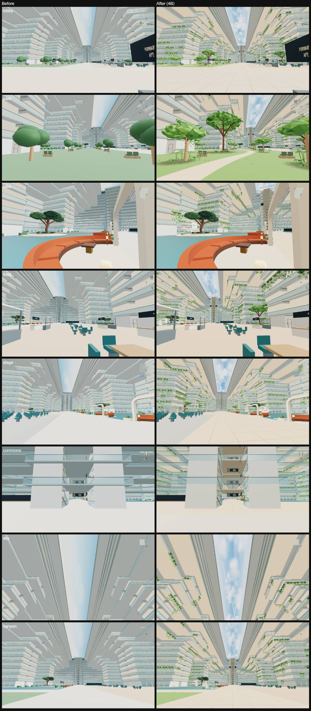
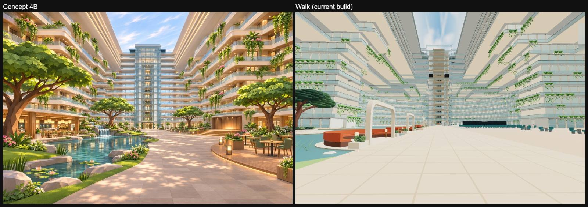
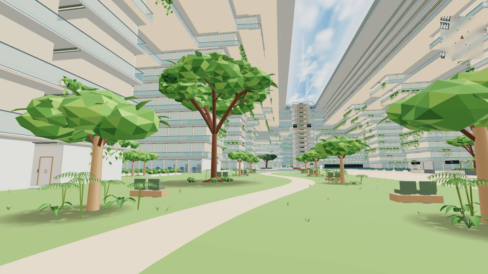
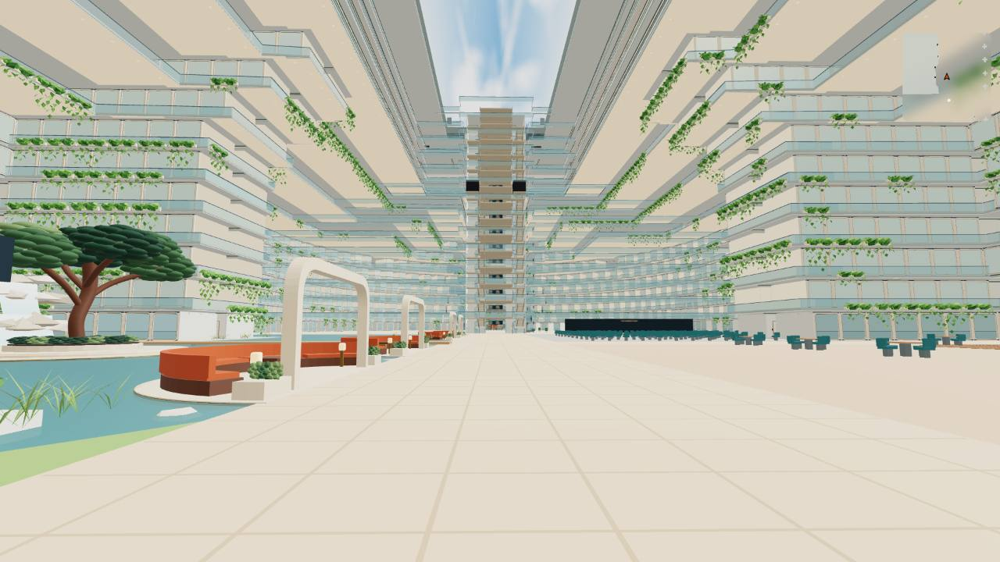

# Deck 6 atrium: 4B hanging gardens

Jay's atrium direction 4B. The Deck 6 atrium reads as a daylit garden: a pale
blue sky panel with cumulus clouds, planting cascading from the balcony slab
edges of Decks 7–15, faceted trees, a lake with stone edges and a rounded lawn
shore, two waterfalls, lily pads, timber decks and a winding park path. While
the walker is in the open atrium, the shared lights ease to a warm tint.

*Left: main. Right: 4B. Same views, fresh browser profiles.*

| Park | Boulevard |
| --- | --- |
|  |  |

## Where it lives

- `src/v2/atrium-gardens.js`: cascades, trees, beds, stones, decks, waterfalls,
  lily pads, soffits, downlights, lanterns, tree shade. All of it is
  `noCollide` and lives in the atrium facade root (`V2_atrium_facade`).
- `src/v2/atrium-daylight.js`: the sky panel and tree-shade canvases.
- `src/walk/atrium-mood.js`: the warm atrium light (no added lights).
- `src/plan/atrium-v2.js`: signature trees, waterfalls, lake shore, park path.

## Rules it keeps

- The sky panel is opaque and Basic. Nothing new crosses the void above Deck 16.
- The five floor zones, routes and seats are unchanged (`check:walk`).
- Distant and phone copies swap to Basic materials; the distant copy uses a
  112-triangle planter, and low-memory phones drop the garden decor.
- Every canopy clears each overhanging deck edge by 1.5 m
  (`check-phase6-canopy-fit`).
- The lake shore reshapes Deck 6 floor colliders, so the atrium PVS key changes;
  a deploy re-bakes it, and the walk uses rays until then.
