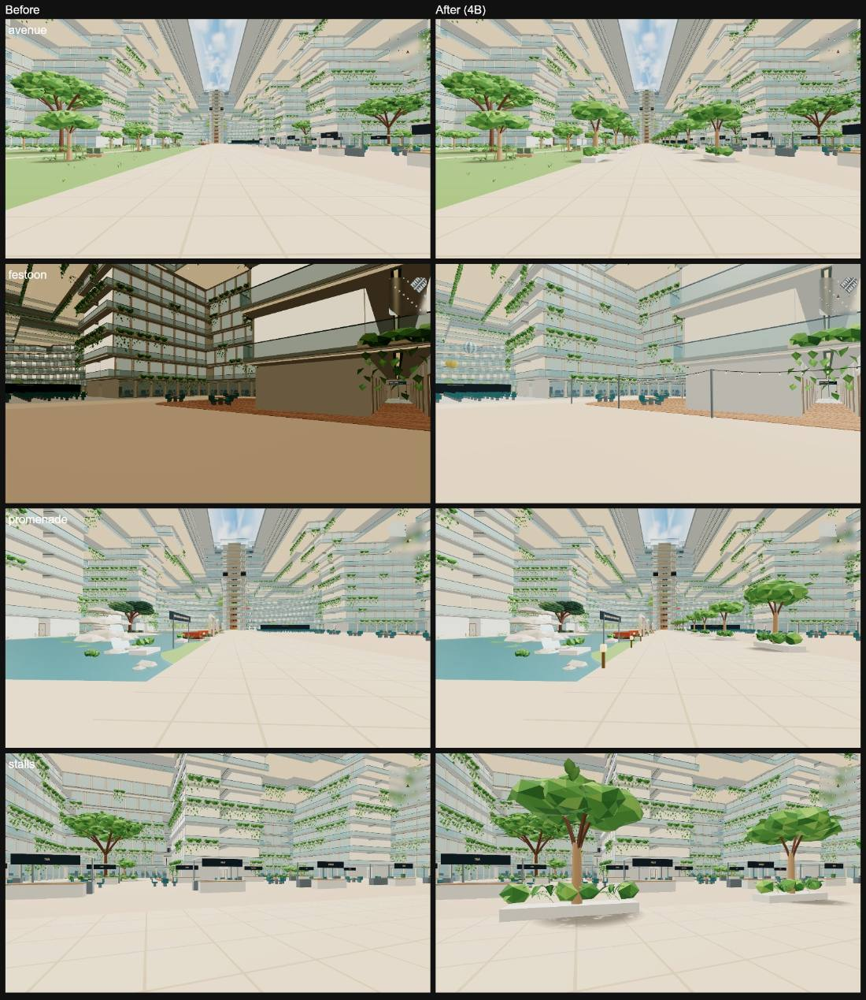
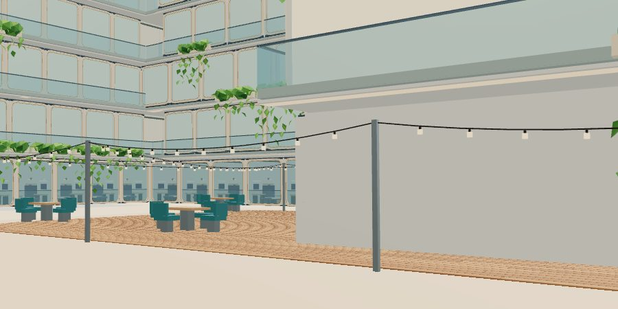
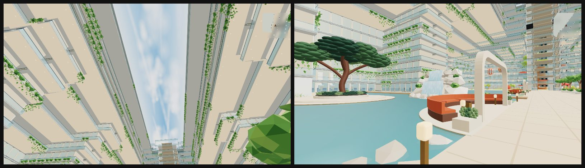
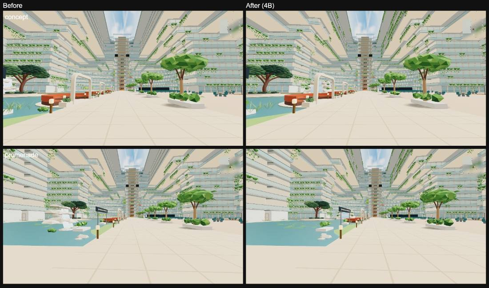

# Deck 6 atrium: 4B hanging gardens

Jay's atrium direction 4B. The Deck 6 atrium reads as a daylit garden: a pale
blue sky panel with cumulus clouds, planting cascading from the balcony slab
edges of Decks 7–15, faceted trees, a lake with stone edges and a rounded lawn
shore, two waterfalls, lily pads, timber decks and a winding park path. While
the walker is in the open atrium, the shared lights ease to a warm tint.

*Left: main. Right: 4B. Same views, fresh browser profiles.*

| Park | Boulevard |
| --- | --- |
|  |  |

## Where it lives

- `src/v2/atrium-gardens.js`: cascades, trees, beds, stones, decks, waterfalls,
  lily pads, soffits, downlights, lanterns, tree shade. All of it is
  `noCollide` and lives in the atrium facade root (`V2_atrium_facade`).
- `src/v2/atrium-daylight.js`: the sky panel and tree-shade canvases.
- `src/walk/atrium-mood.js`: the warm atrium light (no added lights).
- `src/plan/atrium-v2.js`: signature trees, waterfalls, lake shore, park path.

## Rules it keeps

- The sky panel is opaque and Basic. Nothing new crosses the void above Deck 16.
- The five floor zones, routes and seats are unchanged (`check:walk`).
- Distant and phone copies swap to Basic materials; the distant copy uses a
  112-triangle planter, and low-memory phones drop the garden decor.
- Every canopy clears each overhanging deck edge by 1.5 m
  (`check-phase6-canopy-fit`).
- The lake shore reshapes Deck 6 floor colliders, so the atrium PVS key changes;
  a deploy re-bakes it, and the walk uses rays until then.

## Pass 2: avenue, promenade lamps, café string lights

Jay's follow-up after the first pass (all three were the recommended options):

*Left: pass 1. Right: pass 2. The festoon "before" came from a separate capture
run, so its lighting differs.*

- **Boulevard avenue.** 19 short runs line the boulevard's park and food-hall/stage
  edges, each a tree between two 2.4 m planters (4.8 m), with 7.2 m gaps. The
  runs sit between the food-hall stalls, so a gap opens in front of every stall;
  the cross routes at x=-79 and x=2 and the bridge stay open, and so does the
  lake side. The planters and trunks are colliders, so the boulevard keeps
  9.8 m clear (was 12 m) and the atrium PVS key changes again (the deploy
  re-bakes it).
- **Lake promenade lamps.** Ten more of the reflection bays' low brass lamps
  along the promenade edge, every 8 m between the bays and the bridge.
- **Café string lights.** Warm bulbs scallop along the front of both timber
  decks, on slim posts just off their near rims, and criss-cross over the open
  fore end of the larger deck. The rest of each deck lies in a wing approach
  under Deck 7, so the strings stay in open atrium, hanging from 2.75 m. The
  bulbs share the lanterns' draw and the cables the garden draw: no new draws,
  no real lights.

`ATRIUM_BOULEVARD_TREES`, `ATRIUM_PROMENADE_LAMPS`, `ATRIUM_TIMBER_DECKS` and
`ATRIUM_FESTOONS` live in `src/plan/atrium-v2.js`.

## Pass 2b: planting to the top deck, the waterfall as the focal point

Jay's review of pass 2:

- **Hanging gardens on every deck, 7 to 20.** They had stopped at Deck 15, from a
  misreading of the "atrium-centre-clear" decision. That decision keeps walkways
  and solid parts from crossing the void above Deck 16, and planting hung on the
  slab edges crosses nothing. The atrium-void audit (`scripts/atrium-void-v2.mjs`)
  now has a bounded `atrium-edge-planting` allowance:
  - it covers only faces of `P6_hanging_garden_*` meshes;
  - every vertex of a face must lie within 1.2 m of one straight run of a Deck
    16–20 outline, from 4.1 m below that deck's floor to 0.75 m above it (the
    measured envelope of the planters, leaves and vines).

  `check-atrium-void-fixtures-v2` proves it stays bounded: an edge planter passes,
  while each of these fails:
  - the same planter 2.5 m into the void;
  - an edge planter under another name;
  - a planting face spanning the void.

  It adds 285 planters to the same three instanced draws.
- **One focal waterfall** (`ATRIUM_WATERFALL`), placed as in the concept: at the
  far end of the lake's western basin, just short of the bridge, falling back
  toward the boulevard.
  - It replaces the hull-bank waterfall and the mini one, and the far-bank reeds
    return.
  - Rounder rocks stand in three grounded tiers.
  - The falling water is its own mesh with a streak texture. `atrium-mood.js`
    scrolls it while you are in the open atrium, which works in authored and
    prepared builds alike. It costs one draw; the distant copy shares the
    texture.
