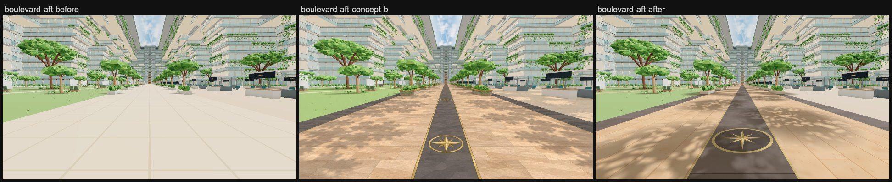
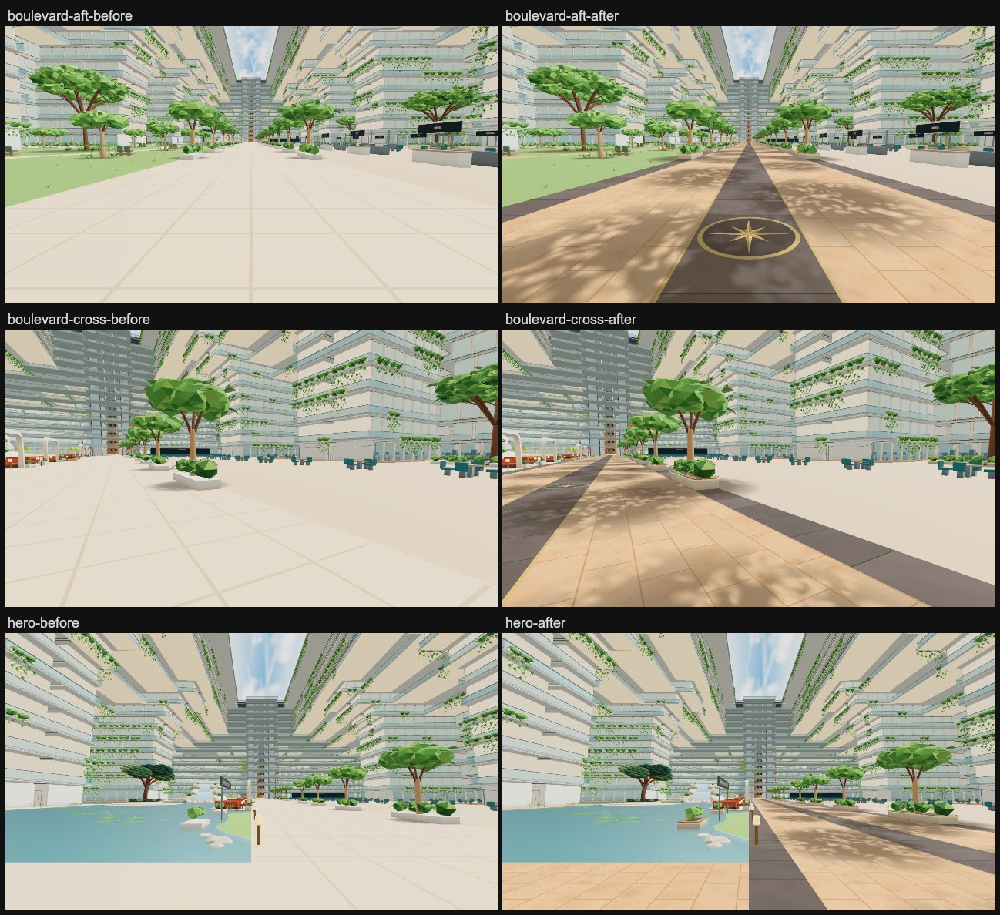

# S1 floor & boulevard: concept B, "inlaid promenade"

Jay's pick for the Deck 6 boulevard floor ([`docs/atrium-areas.md`](../../atrium-areas.md)).

*Before is the live site (`baseline-639f7393`; its atrium floor is the same as `f8af5b3a`). After is a local build of
this branch, captured with `scripts/capture-atrium-areas.mjs`. Both render with three 0.187.*

> **Build with three 0.187.0.** `package.json` pins it, but a stale `node_modules` (0.185.1 was found in the main
> checkout) lights the atrium much darker and warmer: the floor renders 174,150,114 instead of the live 226,217,201.
> Colours judged on such a build come out wrong, so check `node_modules/three/package.json` (or run `npm ci`) first.

## What changed

- **Travertine paving.** Large-format pavers (1.3 x 0.65 m) in a running bond along the ship, painted as a texture
  (`paintTravertine`, `src/v2/atrium-daylight.js`) on the existing paving faces. The texture has round soft clouds
  and small pits, with nothing long and thin, because streaks read as wood grain at a walker's angle. Sunlit pavers
  render about 227,194,157 (concept 224,188,151). Paved faces get world-planar UVs. Every other face samples an 8 cm
  pure-white spot, so lawns, water, the food hall and the stage keep their colours. The arrival lobby and the park
  path take the same pavers. The old 1.5 m joint geometry is gone.
- **Inlays** (`addPromenadeInlays`, `src/v2/atrium-gardens.js`), thin sheets 12 mm over the floor, side by side:
  - a basalt band along both boulevard edges, under the avenue (|z| 4.875..6);
  - a basalt centre stripe edged in brass (1.95 m);
  - a brass compass rose every 20 m (11, x = -84..116).

  The basalt is laid in 1.3 m slabs, set off by 2 cm joints. Each slab varies a little in tone and clouds softly
  from point to point (a per-vertex tone of up to ±8%). It renders about 112,100,90 (concept 108,98,91). Paver rows
  meet the stripe and the bands on whole joints.
- **Dappled shade.** Avenue tree shade is broader (3.4 m, drawn out 1.3x along the boulevard). 56 lighter, more
  broken dapple patches alternate along the boulevard between the trees, as if the crowns met overhead. Both kinds
  sit in the one existing shade draw, each sampling its own half of the shade texture.
- **Planters.** The same collidable boxes and positions, now a stone finish (`phase6-programme.js`, new `stone`
  colour in `phase4-mesh-kit.js`). Each also gets, visual only (`addPlanterTrims`): a paler stone coping, timber bench
  boards, soil, and leaves spilling over the long sides. This covers all 95 Deck 6 atrium planters: avenue, garden
  pockets and lake.

Unchanged:
- the 9.8 m clear width, the gap in front of every stall, and the cross routes at x=-79 and x=2;
- the bridge, and the lake side (no planters added there);
- light and tint.

## Cost and safety

| View | Draws before -> after | Triangles before -> after |
| --- | --- | --- |
| boulevard-aft | 695 -> 695 | 10.81M -> 10.84M |
| boulevard-cross | 502 -> 502 | 10.71M -> 10.73M |
| hero | 558 -> 558 | 10.76M -> 10.78M |

Draws and triangles are the main pass, from the walk's own `?fps=1` readout ([`stats-before.json`](stats-before.json),
a local build of `f8af5b3a`; [`stats-after.json`](stats-after.json)). The readout rounds triangles to 0.01M. The
exact change:

| Change | Triangles |
| --- | --- |
| Paving joints removed | -7,924 |
| Inlays added (537 clouded slabs, joints, brass, 11 roses) | +15,778 |
| Planter trims added (95 planters) | +12,920 |
| Boulevard dapple decals (56, in the shade draw) | +1,344 |
| **Net** | **+22,118** |

The paving texture is 1024 x 512 and the shade texture 512 x 256, both with mipmaps. Distant copies stay Basic: the
floor keeps its map, and the garden mesh keeps its vertex colours. Low-memory phones drop the garden decor from the
distant copy, as before.

- **Floor positions are byte-identical before and after**, so the floor colliders are unchanged.
- **The atrium PVS key is identical** (`4.1485ebc6….af4fce1a….6afd3900…` in both public builds). No re-bake is
  needed.
- **Planter colliders** keep their size and place; only the material name changes.
