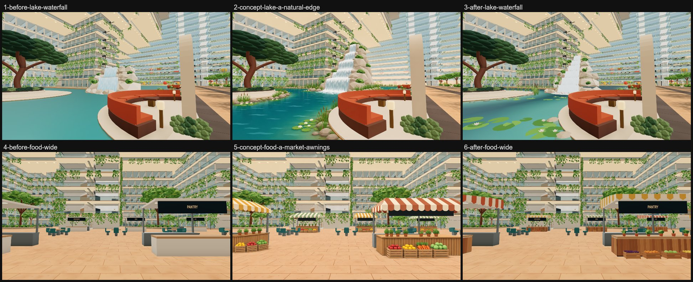
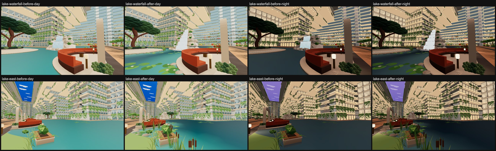
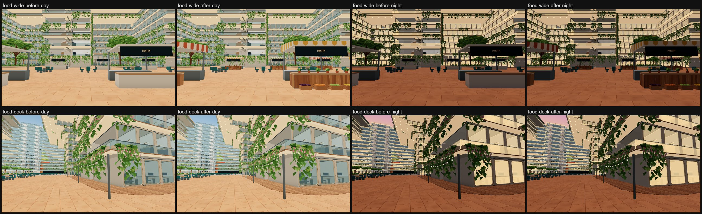

# G3 Reflection lake (lake-a-natural-edge) and G4 Food hall (food-a-market-awnings)

Jay's option A for both ground zones. Everything new is visual only and draws in existing draws, so the walk's
colliders, seats and routes are unchanged and the atrium PVS key stays the same.

- **Lake:** rounded shore stones, cattail reeds and lily pads with small white water lilies along every edge (the
  boulevard bank, the far bank, the reflection island and the bays' outer rims). The waterfall is taller (about 7 m,
  was 5 m), falling ledge to ledge down six tiers in white water. The water is lighter and clearer in the shallows and
  deeper blue-green away from the shore. The outline, bridge, bays, island and the orange-red seating bay are as before.
- **Food hall:** each of the 14 stalls has a striped fabric awning (cream with terracotta, sage or mustard, varied
  along each row and between the rows), a timber-clad counter with six potted herbs, and four wooden crates of fruit
  and vegetables at its front. The sign boards keep their text, and the travertine floor (#478) is untouched.

*Before is a local r187 build (three 0.187.0) of main a7b127ff; after is the refine commit 1c1ab1b8, built in the same
folder (`leo-floor-before`). Captures: `scripts/capture-atrium-areas.mjs
--only=lake-waterfall,lake-east,food-wide,food-deck --query=time=day|night`. The concepts were painted over lighter
captures, so compare hue and pattern, not absolute brightness.*

## What changed

- **New `src/v2/atrium-lake-food.js`**, called by one line in `addAtriumGardens` (`atrium-gardens.js`). Everything it
  makes joins the static garden mesh `P6_atrium_gardens`.
  - *Lake edges* (`addLakeEdge`): edges are sampled every 0.25 m with their normal into the water. Along them go a
    broken line of rounded, flattened stones in warm grey-beige at the waterline, stands of cattails just off it (narrow
    arching blades plus stems with brown heads; lower along the boulevard), and drifts of 7–12 notched pads, about 45 %
    of them flowering, out in the shallows. Smooth noise along each edge makes stands and gaps. A piece goes only
    in open water: clear of the dry islands, the bridge, the waterfall's footprint, every Deck 6 fit-out part and bed (as
    its box) and the reflection floors. 356 stones, 147 reed stands, 491 pads, 202 lilies.
  - *Market stalls* (`addMarketStalls`), for each `p6_stall_canopy`:
    - **Awning:** a striped roof from 3.04 m just over the canopy's front edge up to 3.50 m at the back (the Deck 7 slab
      underside is 3.64 m up). Scalloped valances hang front and back to just above the sign board's top, and striped
      side panels close it down to the canopy.
    - **Counter:** timber boards on its front and ends over a dark backing, with a kick strip.
    - **Herbs:** six terracotta pots of herbs along the counter's front half.
    - **Crates:** four on the floor against the counter, under the awning's front edge, 0.37 m deep. The aisles and
      the gap in front of every stall stay open.
- **`addWaterfall`** (`atrium-gardens.js`): six tiers of rounded rocks step back 0.6 m a tier, each row narrowing as it
  rises. Water falls from the crown down every ledge to the lake, each fall wider than the one above. Foam pools on
  every ledge with bubbles of white water, a spring pool sits on the crown, and the plunge sprays at the foot. Ferns and
  clumps grow on the ledge ends and flowering shrubs at the foot. The mound stays inside the old footprint (its back
  reaches x 58.19; the bridge starts at 58.5). The falling sheets are whiter, and so is their streak texture
  (`paintFallingWater`). They are still the one `P6_atrium_waterfall` draw.
- **New `src/v2/lake-water.js`**, used by `buildPhase6Water` (`atrium-surfaces.js` and its `.authoring` twin):
  - The lake's water sheet is split until no edge is longer than 2.5 m (108 → 12,878 triangles, same area).
  - It takes RGBA vertex colours by distance to the nearest shore, including the island and bay floors. Within about
    a metre the water is lighter turquoise and partly see-through (alpha 0.6 × 0.76); from 4.5 m out it is deeper
    blue-green and opaque.
  - `P6_lake_water` gains `vertexColors`. atrium-mood.js still moves its colour between day and night, multiplying
    the vertex colours, and the distant Basic copy keeps them.

## Costs (walk `?fps=1` readout, 1600×900, median of 6 readings)

| View | Draws before → after | Triangles before → after |
| --- | --- | --- |
| lake-waterfall | 522 → 522 | 8.38M → 8.53M |
| lake-east | 983 → 983 | 11.23M → 11.38M |
| food-wide | 404 → 404 | 8.14M → 8.29M |
| food-deck | 504 → 504 | 8.67M → 8.82M |

Night is the same (523/984/404/505 draws). **No new draws.** Exact counts, from the node probe of the garden build:
`P6_atrium_gardens` 333,524 → 474,614 triangles (+141,090, including the waterfall sheets that the browser draws
separately) and the lake water 108 → 12,878, so about +154k triangles on every atrium view (+1.8 %). The garden
mesh has no frustum culling, so the cost is the same wherever you stand. Distant copies stay Basic, and phones drop
them with the other garden decor (`gardenDecor`).

## Checks (run in `leo-floor-before` on the r187 build of 1c1ab1b8)

| Check | Result |
| --- | --- |
| `npm run check:walk` | PASS (823 s) |
| `node scripts/check-phase6-v2.mjs` | PASS, all 12 tasks (atriumVoid PASS) |
| `node scripts/check-prepared-runtime-migration.mjs` | PASS |
| `npm run check:atrium-time` | PASS |
| `node scripts/check-atrium-void-fixtures-v2.mjs` | PASS |
| `node scripts/check-prepared-walk-v2.mjs` | PASS |
| `node scripts/check-void-guards-v2.mjs` | PASS |
| `node scripts/check-lobby-tile-v2.mjs` | PASS |
| `node scripts/check-main-features-v2.mjs` | PASS |

The first build of 61a1e23a (before the refine) passed all nine too.

**Atrium PVS key:** `4.63d7c93282b3f79b647143e90093b6df.aaba3802c109794758a3fffa000069ed.6afd3900849f657047053acc00000001`,
identical to main a7b127ff's. Nothing is baked for it on main either, so there is nothing to re-bake. No pin rows needed
changing.

## Notes

- **The water's look is mostly the environment's reflection.** With the reflection turned off in a preview, the
  water drops to about (2, 49, 45); with it on, the deepest water still reads about (73, 123, 126) by day, against the
  concept's (6, 102, 112). Going deeper would need the water's own reflection strength turned down (a runtime
  `envMap`/`envMapIntensity` on `P6_lake_water`, which atrium-mood.js would then also have to dim at night). That is
  out of scope here.
- **Crates sit just outside the stall's 4 × 3 m footprint.** The counter fills the front of that footprint, so they
  stand 0.37 m in front of it, under the awning's edge. That keeps the concept's look and every aisle open.
- **Shared file:** `atrium-gardens.js` is touched in `addWaterfall`/`waterSheet`/`paintFallingWater`, plus one
  import, one call line and `lakeFood` in `addAtriumGardens`' return. The lobby + park and stage jobs also add lines
  in `addAtriumGardens`, so expect a small, easy merge there.
