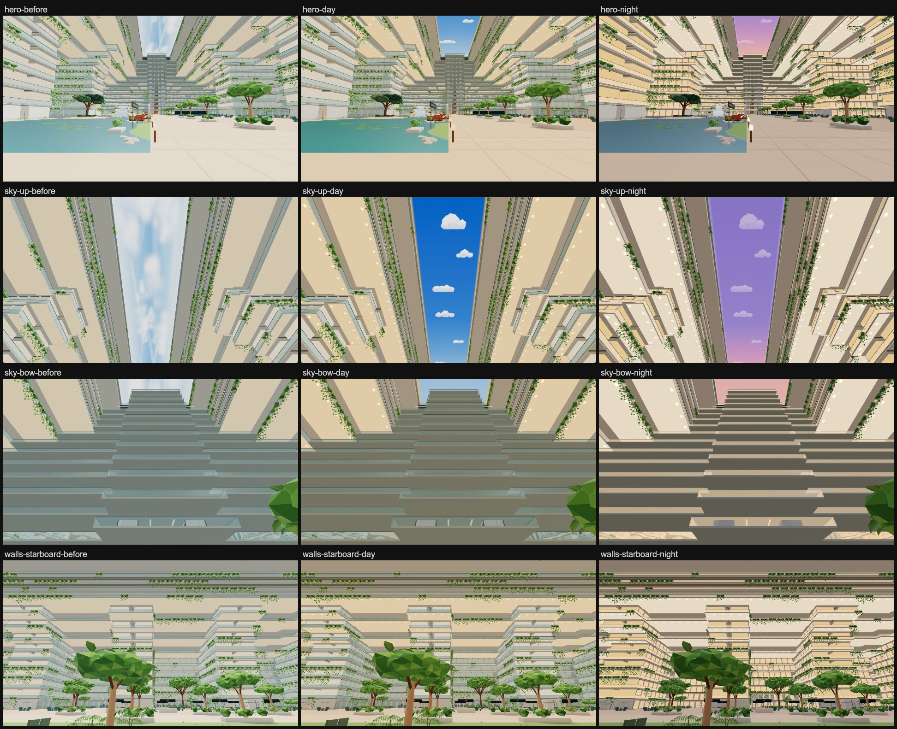
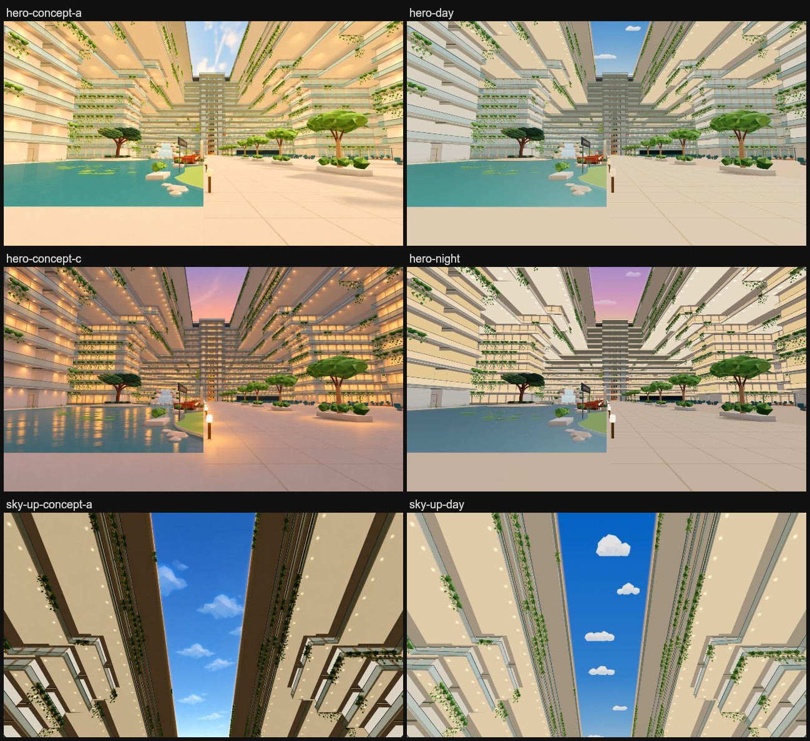

# S4 light & palette: day and night, and sky concept A

The Deck 6 atrium's light follows a ship clock ([`docs/atrium-areas.md`](../../atrium-areas.md)): concept A (warm
daylight, softened) by day, concept C (evening) by night. The Deck 20 sky panel's day picture is sky concept A (deep
sky); at night it is recoloured to concept C's dusk.

*Before is the live site at 639f7393 (`baseline-639f7393`). Day and night are this branch at 42113d02 on three
0.187.0, held with `?time=day` / `?time=night`, captured with
`scripts/capture-atrium-areas.mjs --only=hero,sky-up,sky-bow,walls-starboard [--query=time=night]`. Three 0.187
builds render like the live site; see "Local renders" below.*

## How it works

- **Ship clock** (`src/walk/ship-time.js`): night is 20:00 to 06:00 New York time, read with `Intl` in that time
  zone, so every visitor sees the same time whatever their own clock says. It blends over half an hour, 19:30 to 20:00
  and 06:00 to 06:30, through daylight saving changes. Detail > *Atrium time of day* offers Auto (the clock, the
  default), Day or Night, remembered on the browser like *Look*. `?time=day|night` holds one for a single visit and
  doesn't change the saved choice. A change in the menu eases over about two seconds.
- **Light** (`src/walk/atrium-mood.js`): the existing atrium mood, which already eases the ship's shared hemisphere
  and fill lights while the walker is in the open atrium, now lerps between a day and a night palette. This covers
  intensity, sky/ground/fill colour, environment strength and fog colour. It restores the ship-wide base once on
  leaving, as before.
  - Day: a warmer, brighter hemisphere with a light golden ground colour, so the balcony undersides glow gold as in
    concept A; less of the neutral environment light.
  - Night: a dimmer pink-lavender dusk light with a warm ground bounce.
- **Materials**, found by name:
  - room interiors seen through the balcony glass (`P6_atrium_room_returns`, unlit) glow amber at night: concept C's
    lit windows;
  - balcony and cabin glass (`V2_smart_glass`, `V2_cabin_view_glass`, changed only while in the open atrium, since
    the rest of the ship shares them) gain a warm amber emissive, 1.5x as strong, at 1.74x opacity;
  - soffits (`V2_atrium_soffit`) are warm gold by day and bright cream at night;
  - promenade lamps (`P4_reflection_light`) go up 4x at night;
  - water (`P6_lake_water`) is teal by day and blue-grey at night.
- **Sky panel**:
  - Day (`paintDaylightSky`, `src/v2/atrium-daylight.js`), sky concept A: a clear, deep blue brightening toward the
    bow where the sun is, with stylised low-poly clouds (fans of flat facets, white on top, pale blue-grey underneath)
    lying across the atrium. It stays blue to the long edges, so the panel meets the top decks crisply, with a thin
    warm rim of sunlight there. One canvas on the one shared material, so the near, distant and phone copies change
    together and nothing hangs below the panel.
  - Night (`src/walk/atrium-light-paint.js`): the day picture recoloured in the page to a lavender wash turning rose
    and then peach toward the bow, mostly covering the clouds. It is swapped on the one shared texture; blends
    between day and dusk are cached in 16 steps.
- **Downlight pools**: the existing instanced `P6_atrium_downlights` draw gets an additive radial texture, with its
  discs scaled 3.2x to hold a soft pool on the soffit. The pools are faint by day and full at night.

No lights or meshes are added. `src/walk/*` is outside the prepared geometry identity; `atrium-daylight.js` is inside
it (the sky picture), so a build needs `build-fast-v2`. No collider changes, so the atrium PVS key stays as built.

## Local renders

Builds that bundle three 0.185.1 render far darker and browner than the live site: under r185 the baked environment
light (`brand/environment-cube.png`, an r187 PMREM cube) contributes nothing. The shared `leo-threejs\node_modules`
had 0.185.1 while package.json pins 0.187.0, and every local build used it until 2026-11-09. This branch's first
palettes (2e9adbda) were tuned on those renders. d77b09eb retuned them on an r187 render that matches the live site,
side by side with the concepts. Build with `node_modules/three` at 0.187.0.

## Cost

| View | Draws base -> day / night | Triangles base -> day / night | Programs |
| --- | --- | --- | --- |
| hero | 558 -> 558 / 558 | 10,760,649 -> 10,760,649 / 10,760,649 | 297 -> 297 |
| walls-starboard | 613 -> 613 / 613 | 11,067,498 -> 11,067,498 / 11,067,498 | 297 -> 297 |
| sky-up | 533 -> 533 / 533 | 10,560,360 -> 10,560,360 / 10,560,360 | 297 -> 297 |
| sky-bow | 467 -> 467 / 467 | 10,823,265 -> 10,823,265 / 10,823,265 | 297 -> 297 |

These are main-pass draws and triangles from the debug review walk (`scripts/launch-a-measure.mjs` `measure()`, 90
frames): [`stats-after.json`](stats-after.json) for this branch on three 0.187. Base numbers:
- hero, walls-starboard and sky-up draws and triangles are from f8af5b3a (the earlier r185 measurement in git history;
  three's version doesn't change draws or triangles);
- hero and sky-bow programs and sky-bow's numbers are from an r187 build of the lift-tower branch, less its tower copy's
  5,640 triangles ([`stats-before.json`](stats-before.json)).

Both measure 297 programs on r187 (287 on r185). Per frame, the open atrium still costs a few colour and uniform
lerps, as the mood did before. A dusk or dawn blend re-uploads the one sky texture at most 16 times.

## Checks

- `npm run check:atrium-time` (no GPU):
  - New York time across both DST changes;
  - another time zone sees the same ship hour;
  - the blend table;
  - the stored choice and `?time`;
  - what the mood changes at night and restores on leaving the atrium or switching to Day.
- `npm run check:walk`, `scripts/check-phase6-v2.mjs` and `scripts/check-prepared-runtime-migration.mjs` on the r187
  build of 42113d02.

## Not covered

- Phones have no Detail sheet, so they follow Auto (the clock) or `?time=` only.
- Concept C's glow is not reproduced: no bloom, no lamp pools on the floor, and the lake doesn't reflect the lamps or
  windows (no screen-space reflections).
- Sky concept A's clouds are larger and softer-edged than the low-poly ones here.
- The ship outside the open atrium keeps its one base light at every hour.
