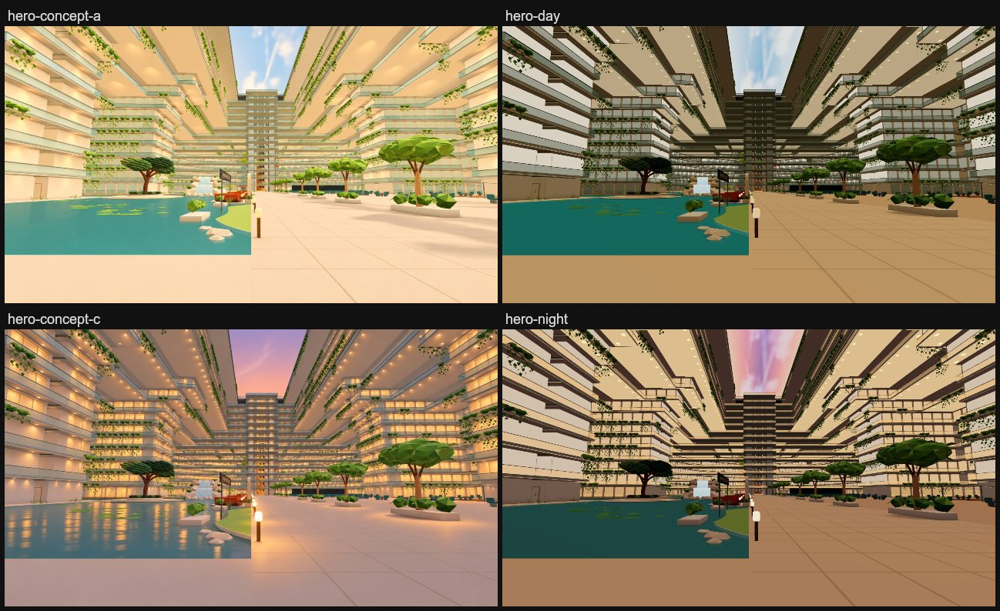

# S4 light & palette: day and night

The Deck 6 atrium's light follows a ship clock ([`docs/atrium-areas.md`](../../atrium-areas.md)): concept A (warm
daylight, softened) by day, concept C (evening) by night.

*Before is a local build of f8af5b3a; day and night are this branch on the same prepared geometry (the change is
runtime-only), held with `?time=day` / `?time=night`. All three are local renders, captured with
`scripts/capture-atrium-areas.mjs --only=hero,sky-up,walls-starboard [--query=time=night]`. Local builds render darker
than the live site, so compare them with each other.*

## How it works

- **Ship clock** (`src/walk/ship-time.js`): night is 20:00 to 06:00 New York time, read with `Intl` in that time
  zone, so every visitor sees the same time whatever their own clock says. It blends over half an hour, 19:30 to 20:00
  and 06:00 to 06:30, through daylight saving changes. Detail > *Atrium time of day* offers Auto (the clock, the
  default), Day or Night, remembered on the browser like *Look*. `?time=day|night` holds one for a single visit and
  doesn't change the saved choice. A change in the menu eases over about two seconds.
- **Light** (`src/walk/atrium-mood.js`): the existing atrium mood, which already eases the ship's shared hemisphere
  and fill lights while the walker is in the open atrium, now lerps between a day and a night palette. This covers
  intensity, sky/ground/fill colour, environment strength and fog colour. It restores the ship-wide base once on
  leaving, as before.
- **Night glow**, on materials found by name:
  - balcony and cabin glass (`V2_smart_glass`, `V2_cabin_view_glass`, changed only while in the open atrium, since
    the rest of the ship shares them) gain a warm amber emissive at 1.5x opacity;
  - soffits (`V2_atrium_soffit`) brighten;
  - promenade lamps (`P4_reflection_light`) go up 2.6x;
  - room returns (`P6_atrium_room_returns`) warm.
- **Water** (`P6_lake_water`): bluer turquoise by day (it read green under the warm light), mid teal at night.
- **Sky** (`src/walk/atrium-light-paint.js`): the dusk is painted in the page from the panel's own day picture:
  - its clouds are recoloured lavender down the middle and rose to peach at the edges, warming toward the bow;
  - the image is swapped on the one texture the near, distant and phone panels share;
  - blends between day and dusk are cached in 16 steps.
- **Downlight pools**: the existing instanced `P6_atrium_downlights` draw gets an additive radial texture, with its
  discs scaled 3.2x to hold a soft pool on the soffit. The pools are faint by day and full at night.

No lights, meshes or prepared geometry change. `src/walk/*` is outside the prepared geometry identity, so the prepared
data and the atrium PVS stay as built.

## Cost

| View | Draws before -> day / night | Triangles before -> day / night | Programs |
| --- | --- | --- | --- |
| hero | 558 -> 558 / 558 | 10,760,649 -> 10,760,649 / 10,760,649 | 287 -> 287 |
| walls-starboard | 613 -> 613 / 613 | 11,067,498 -> 11,067,498 / 11,067,498 | 287 -> 287 |
| sky-up | 533 -> 533 / 533 | 10,560,360 -> 10,560,360 / 10,560,360 | 287 -> 287 |

These are main-pass draws and triangles from the debug review walk (`scripts/launch-a-measure.mjs` `measure()`, 90
frames): [`stats-before.json`](stats-before.json), [`stats-after.json`](stats-after.json). Per frame the cost is still
a few colour and uniform lerps in the open atrium, as the mood was before. A dusk or dawn blend re-uploads the one sky
texture at most 16 times.

## Checks

- `npm run check:atrium-time` (new, no GPU):
  - New York time across both DST changes;
  - another time zone sees the same ship hour;
  - the blend table;
  - the stored choice and `?time`;
  - what the mood changes at night and restores on leaving the atrium or switching to Day.
- `npm run check:walk`, `scripts/check-phase6-v2.mjs` and `scripts/check-prepared-runtime-migration.mjs` pass on this
  branch's build.

## Not covered

- Phones have no Detail sheet, so they follow Auto (the clock) or `?time=` only.
- The lake darkens at night but doesn't reflect the lamps or windows (no screen-space reflections).
- The ship outside the open atrium keeps its one base light at every hour.
