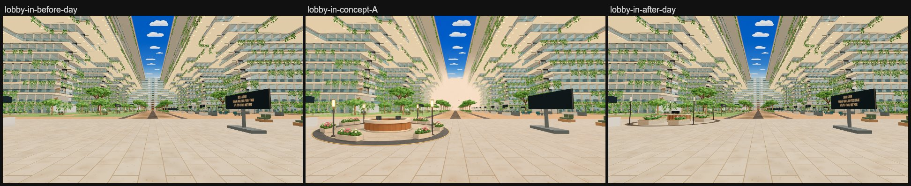
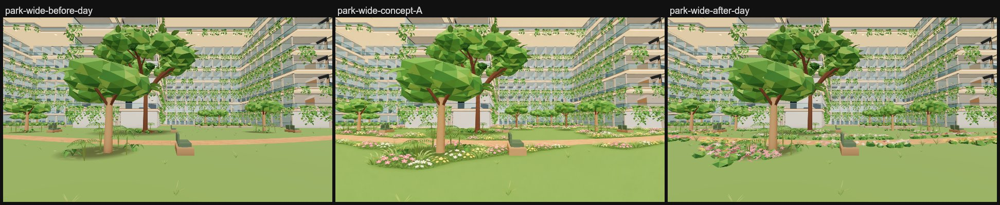
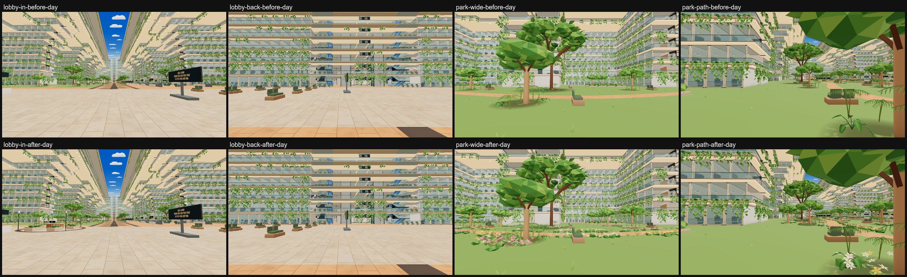
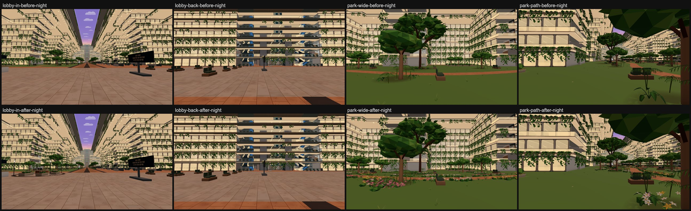
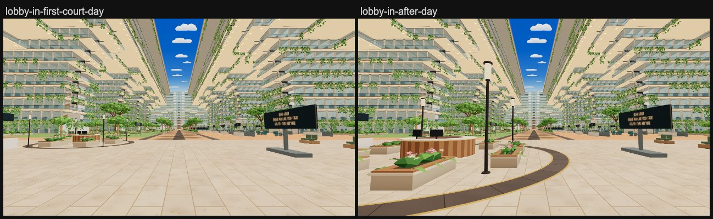
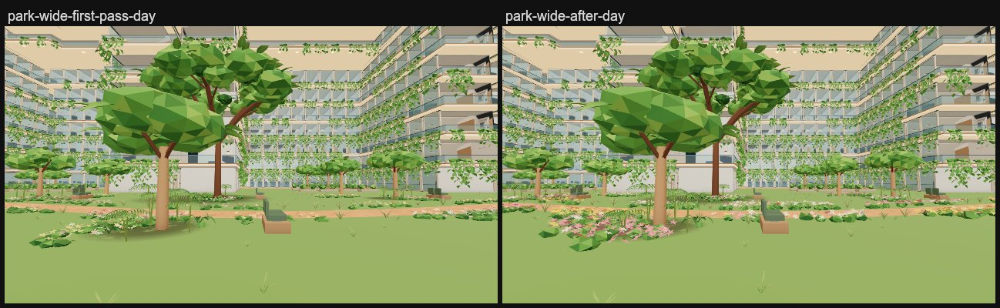
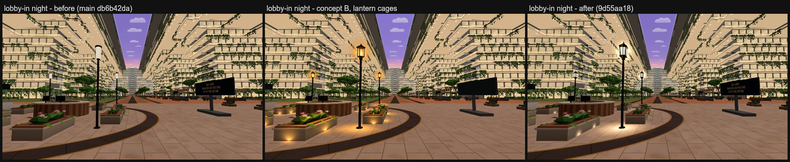
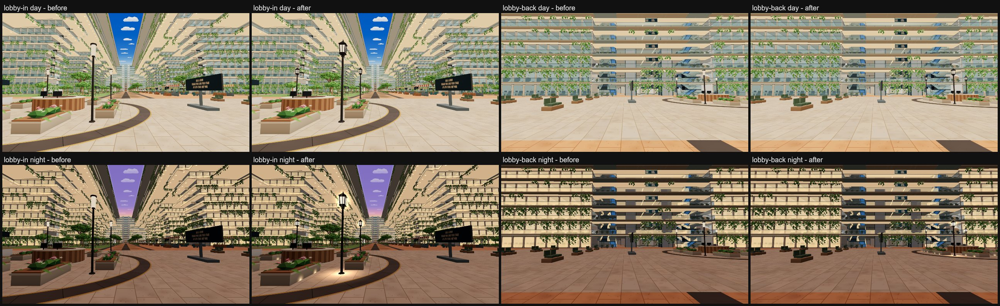
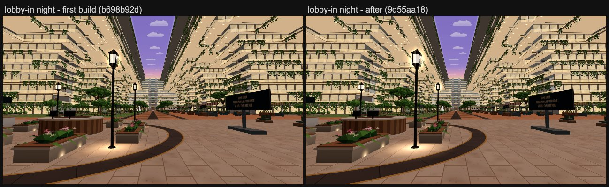

# G1 Arrival lobby: welcome court (option A) · G2 Voyager park: flower meadow (option A)

**G1:** a round welcome desk is the arrival plaza's focal point, in the middle ground of the arrival view just port of
the centre line. It is warm timber slats under a cream stone top, with a thin brass band and two screens facing the
lifts. Around it:

- a ring of eight low stone planters with pink and white flowering shrubs;
- four bronze lamp posts with glowing lanterns;
- a round basalt inlay edged in brass, like the boulevard's inlays.

The walk to the boulevard flows round the court on both sides. The black directory sign and the reception counter
stay.

**G2:** drifts of soft pink, white and pale yellow flowers run over low leafy mounds:

- along both edges of the park path and beside the grove trees;
- with ornamental grasses in the gaps and behind the drifts.

Two more small trees join two of the grove trees. The open lawn in the middle stays open.

*How these were made:*
- **Before** is a local r187 build (three 0.187.0) of main a7b127ff. atrium-lake-food built it in `leo-floor-before`
  and captured it for all three ground-zone jobs (`C:\Users\victo\Leo\atrium-before-a7b127ff\lobbypark-before-*`).
- **After** is from r187 builds of this branch in `leo-build-2`:
  - the lobby views from f201bd87, the court refine;
  - the park views from 1e582352, the meadow refine. f201bd87 changes nothing in the park.
- **Captures:** `scripts/capture-atrium-areas.mjs --query=time=day|night` at 1600×900.
- **Concepts** were painted over the live captures, so compare layout and colour, not exact distance.

## What changed

Everything lives in a new module, `src/v2/atrium-lobby-park.js`. Shared files get one-line hooks, so sibling area jobs
merge easily:

- `src/v2/phase6-programme.js`: `addWelcomeCourtParts(add,y)` after the lobby's planters adds the court's collidable
  parts.
- `src/v2/atrium-gardens.js`: `addLobbyPark(out,glow,layout,clearGround,parts)` in `addAtriumGardens` adds everything
  drawn to the existing garden mesh (`P6_atrium_gardens`) and the lamp glow to the existing lantern draw
  (`P6_atrium_lanterns`, material `P6_atrium_glow`). That draw is one plain colour by day and night; the lanterns'
  night light is separate, see [Lantern cages](#lantern-cages-concept-b).
- `src/v2/atrium-architecture.js` and its `.authoring.js` twin: one branch next to the terrace-glass hook hides
  collision-only fit-out parts (`P4_p6_*_collider`), with `phase6ArchitectureSource` so culling, phone merging and
  furnishing batches leave them hidden.

### G1 welcome court

**Placement (f201bd87, Jay's refine).** At first (d5269e44 to 1e582352) the court sat about 20 m off on the port side,
radius 5.2 m and rim clear of |z| < 4.9, so from lobby-in it read as a small cluster on the horizon. Jay asked for it
nearer, bigger and closer to the centre line, with the walk flowing round it.

It is now centred at (−110, −5.5), radius 7.48 m to the outer brass line, about 1.4× the old diameter:
- From lobby-in it stands 11 m away and 29° to the left, as in concept A.
- The flat, walkable inlay crosses the centre line by 2 m.
- **Walking room around it:**
  - From the planters and lamps to the directory sign: 7.2 m.
  - From the planters and lamps to the benches beyond: 14 m.
  - To port: 3 m of open paving before the reception counter.
- **Clearances to what stays:** the inlay clears the reception counter by 0.46 m and the directory sign by 4.5 m.

| Piece | Details |
| --- | --- |
| Desk | 3.8 m across (radius 1.9 m drum), 1.1 m high. Cream stone plinth, 56 alternating timber slats, brass band, cream stone top with a leather inset, two screens on the aft side. |
| Planters | Eight of the boulevard's own stone planters (2.4 × 0.42 × 1.1 m), 45° apart on a 4.6 m ring from 22.5°. 2.4 m openings fore and aft, 1.1–1.4 m gaps elsewhere, and a 1.3 m aisle round the desk. `addPlanterTrims` gives them the same coping, timber bench boards and spilling leaves. They are square to the ship because the trims are laid unrotated. Each holds leafy mounds and 22 pink and white flowers. |
| Lamps | Four, between the planters on the diagonals at 5.3 m: bronze base, 3.4 m post (5–6.5 cm) and collar. The lantern on top was first a plain glowing cylinder, then a cage lantern; see [Lantern cages](#lantern-cages-concept-b). |
| Inlay | Basalt band from 6.6 to 7.4 m in 36 slabs, each clouded and set off by a 2 cm joint, between brass lines 8 cm wide. Same stone, brass and clouding as `addPromenadeInlays`, 12 mm over the floor. |

### G2 flower meadow

**Path drifts.** Along both edges of the path (`phase6ParkPath`), drifts 4–8 m long and 1.3–2.4 m deep hug the edge
with 1.4–3.8 m gaps. Each drift is:

- leafy mounds, 2.2 per m²;
- flowers on top, 16 per m², 11–16 cm across: five kite petals round a yellow eye, eleven triangles each, tipped up
  toward the viewer;
- one dominant colour (pink, white or yellow) mixed with the others.

Ornamental grasses (11–14 arching blades, pale straw tips) stand in the gaps and along each drift's back edge.

**Grove drifts.** One drift beside each grove tree, off to one side of its trunk.

**Two new small trees** at (−37.5, −30.5) and (−62.5, −31), each about 5 m from a grove tree, on the lawn beyond the
path. They use the grove's crown recipe and are 3.8–4 m tall.

**Kept clear:**
- The open lawn in the middle: x −46.5..−36.5, z −15..−6, park-wide's foreground.
- The cross route at x −81..−77.
- The path itself, the boulevard's planter edge (z > −6.6), and every fit-out footprint (benches, planters, signs)
  through `addAtriumGardens`' ground test.

**Refine pass (1e582352).** The first build read weaker than the concept: pale flowers over flat dark mounds, and
sparse drifts. The flowers are now larger and stronger in colour and sit on lighter, leafier mounds. The drifts are
deeper with shorter gaps, and more grasses stand behind them.

## Colliders and the atrium PVS key

**The desk and its planters collide**, as the atrium's existing planters and counters do:

- The planters are `garden_planter` parts with the same size and material as the boulevard and lake planters, so they
  join that instanced batch.
- The round desk is stood in for by four crossed boxes (3.7 × 1.1 × 1.56 m, 45° apart). Together they fill the drum
  to within 0.1 m.
- Those boxes are a new part, `p6_welcome_desk_collider`, that nothing draws.

**Everything else is visual only (noCollide):** the lamps, the inlay, the planting and the two new park trees. The
trees have trunks but no collider and no tree-shade decal; the brief asked for visual-only park additions.

**The atrium PVS key changes** by the new collider instances. No atrium PVS is baked for any of these keys, so nothing
needs rebaking today.

| Build | Collider instances added | Atrium PVS key |
| --- | --- | --- |
| Before (a7b127ff) | none | `4.63d7c93282b3f79b647143e90093b6df.aaba3802c109794758a3fffa000069ed.6afd3900849f657047053acc00000001` |
| 80a6723d, 1e582352 (first court) | 10: 4 desk boxes, 6 planters | `4.63d7c93282b3f79b647143e90093b6df.ea939c7cb1d180dda21af481000069f7.6afd3900849f657047053acc00000001` |
| **f201bd87 (refined court, current)** | 12: 4 desk boxes, 8 planters | `4.63d7c93282b3f79b647143e90093b6df.7a47367b508a92a926595c9d000069f9.6afd3900849f657047053acc00000001` |

## Cost

Draws and triangles come from the walk's `?fps=1` readout (median of 6 readings), measured the same way as the
before set. Lobby rows are from f201bd87, park rows from 1e582352.

| View | Time | Draws before → after | Triangles before → after |
| --- | --- | --- | --- |
| lobby-in | day | 878 → 878 | 10.42M → 10.50M |
| lobby-back | day | 489 → 490 | 8.00M → 8.09M |
| park-wide | day | 391 → 391 | 8.59M → 8.67M |
| park-path | day | 787 → 787 | 10.31M → 10.39M |
| lobby-in | night | 879 → 879 | 10.42M → 10.50M |
| lobby-back | night | 489 → 490 | 8.00M → 8.09M |
| park-wide | night | 391 → 391 | 8.59M → 8.67M |
| park-path | night | 788 → 788 | 10.31M → 10.39M |

- **No new draw call.** Everything drawn joins the existing garden mesh and lantern draw. The hidden desk boxes are
  never drawn.
- **lobby-back +1 draw:** it is the existing `garden_planter` batch. Before, none of its instances were in that view
  (the boulevard and lake planters are behind the camera). Now the court's planters are in view, so the batch draws
  there.
- **Garden mesh (`P6_atrium_gardens`):** 333,524 → 414,294 triangles in a Node build (+80,770): the court ~7.5k with
  its planters' trims, the meadow ~73k. The walk counts 414,198 at the lobby views.
- **Lantern draw:** 1,632 → 1,824 triangles (+192, the four lanterns).
- **Distant and phone copies:** the garden mesh's distant copy keeps its Basic material swap, and phones drop distant
  decor as before. Both apply automatically because nothing new has its own mesh.
- **Measure on an idle machine.** A first capture of f201bd87, taken while `check:walk` started on the same machine,
  showed 840 draws at lobby-in, with the far end of the atrium still streaming into haze. Re-captured idle, it reads
  878 as above, and the far tower is back.

## Checks

All run in `leo-build-2` on the r187 build of each commit.

| Check | 80a6723d (first build) | 1e582352 (meadow refine) | f201bd87 (court refine) |
| --- | --- | --- | --- |
| `npm run check:walk` | PASS | PASS | PASS |
| `node scripts/check-phase6-v2.mjs` (incl. phase6-sanity's 2.4 m perimeter rule and phase6-prepared's hidden-source rule) | PASS | PASS | PASS |
| `node scripts/check-prepared-runtime-migration.mjs` | PASS | PASS | PASS |
| `npm run check:atrium-time` | PASS (12 checks) | PASS (12 checks) | PASS (12 checks) |
| `node scripts/check-atrium-void-fixtures-v2.mjs` | PASS | PASS | PASS |
| `node scripts/check-prepared-walk-v2.mjs` | PASS | PASS | PASS |
| `node scripts/check-void-guards-v2.mjs` | PASS | PASS | PASS |
| `node scripts/check-lobby-tile-v2.mjs` | PASS | PASS | PASS |
| `node scripts/check-main-features-v2.mjs` | PASS | PASS | PASS |

- `check:walk` floods the ship as a walker: every room's floor, every lift landing and every seat must be reached.
  It passes with the walk flowing round the court.
- No source re-pinning was needed: none of the required checks complained about the switchover pins.
- `scripts/check-source-fold.mjs` (not on this job's list) already fails on main a7b127ff, at `server/live-core.mjs`,
  unrelated to this change.

**Every area job keeps:**
- Nothing is added above Deck 16, and no opaque `noCollide` surface crosses the void: everything here sits on the
  Deck 6 floor.
- The walk from the aft lifts to the boulevard is clear on both sides of the court, and the boulevard's 9.8 m clear
  width begins forward of it.
- The x=−79 cross route stays clear.
- The x=2 cross route and the stall gaps are outside these zones.

## Lantern cages (concept B)

Jay picked concept B of three for the court's lamps, whose heads read pale and unlit at night:

- **Lanterns:** each post now carries a classic dark metal lantern cage round a warm glowing core.
- **Night light:**
  - a soft warm pool on the paving under each post;
  - a faint warm halo round each head;
  - small warm uplights at the foot of the court's planters.

The desk, planters, inlay, directory sign and everything else are unchanged.

**How these were made:**
- **Before:** an r187 build of origin/main db6b42da.
- **After:** an r187 build of 9d55aa18, on top of the before build in `leo-build-2`.
- **Captures:** `scripts/capture-atrium-areas.mjs --query=time=day|night` at 1600 × 900.
- **Concept:** painted over a live capture, so its framing and its sign differ. Codex blanked the sign's text; the real
  sign is unchanged.

### The lantern

The lantern stands 4.45 m tall in all; its dark metal is `0x2a2623`, in `P6_atrium_gardens`. From the post's collar up:

| Piece | Details |
| --- | --- |
| Base | A flared square cup and a 0.32 m base plate. |
| Glass core | 0.48 m tall, widening from 0.23 to 0.29 m. It sits in the lantern draw `P6_atrium_lanterns` and glows cream, like every lantern there. |
| Cage | A bar up each corner, a rim at the top and bottom of the glass, and a thin mullion down each face. |
| Roof | An eaved pyramid roof with a ball-and-spike finial. |

The court's placement now lives in `src/v2/welcome-court.js`: plain numbers that `atrium-lobby-park.js` builds from and
the walk lights from.

### The night light, and the mechanism chosen

**What the existing mechanisms do:**
- **The lantern draw** that the deck lanterns and festoon bulbs share has no night mechanism. It is one opaque Basic
  colour, the same by day and by night. So soft pools, halos and uplights cannot live in it: they would show by day as
  solid shapes.
- **The atrium's one night-only light** is the promenade lamps' floor pools (`P6_atrium_lamp_pools` in
  `atrium-mood.js`). It is an additive instanced draw, shown only at night, so by day it costs nothing. But it is a
  child of the lamps' instanced stems, and the culling hides those stems whenever no promenade lamp is in sight, as at
  lobby-back. Pools added to that draw would vanish there.

**What the court uses:** the same mechanism, in a draw of its own. `atrium-mood.js` builds `P6_atrium_court_glows`, one
instanced draw of 48 soft additive squares carrying the promenade pools' picture (`paintLampPool`):

| Glow | Count | Placement | Strength |
| --- | --- | --- | --- |
| Pools | 4 | 3.6 m, flat on the paving under each post | 0.85 |
| Halos | 4 × 3 | 1.3 m, three crossed upright squares round each core, so they read from every side | 1 |
| Uplights | 8 × 4 | 0.55 m, upright on both long faces of each planter at its foot. The lower half is under the floor, so each shows as a glow rising up the stone | 1 |

**When it shows:**
- Its opacity follows the clock's night value, as the promenade pools do. It is visible only at night (night > 0.01)
  while the walker is in the open atrium.
- By day it is hidden: no draw and no mark on the paving. The day captures match before.
- It draws in one pass. `forceSinglePass` stops three.js drawing a transparent double-sided material back then front,
  which cost the first build two draws.
- It is built at runtime, so the distant copies are not affected: they stay Basic, and phones drop distant decor as before.

**Why it is not in the lantern draw:** the brief asked for cores, halos and uplights to join the lantern draw, with no
new draws. The cores do join it. The halos, pools and uplights are this one night-only draw instead, because the lantern
draw cannot fade by time of day.

### Colliders and the PVS key

Everything here is visual only. phase6Programme's fit-out parts, which the colliders and the PVS key come from, are
identical to origin/main's: 2,645 parts, SHA-1 of the list ad2fa4b6 on both. So the atrium PVS key does not move.

### Cost

Draws and triangles come from the walk's `?fps=1` readout, median of 6 readings. Before is db6b42da, after is
9d55aa18.

| View | Time | Draws before → after | Triangles before → after |
| --- | --- | --- | --- |
| lobby-in | day | 876 → 876 | 10.69M → 10.69M |
| lobby-back | day | 488 → 488 | 8.28M → 8.28M |
| lobby-in | night | 877 → 878 | 10.69M → 10.69M |
| lobby-back | night | 488 → 489 | 8.28M → 8.28M |

- **At night, +1 draw** wherever the court is in view: the court's glows, 96 triangles.
- **By day, nothing changes.**
- **Garden mesh** (`P6_atrium_gardens`, Node build): 592,260 → 593,588 triangles (+1,328, the four cages).
- **Lantern draw:** 1,824 → 1,696 triangles (−128). The square cores have fewer faces than the old round lanterns.

### Checks

All nine run in `leo-build-2` on the r187 build of 9d55aa18, and all pass:

| Check | 9d55aa18 |
| --- | --- |
| `npm run check:walk` | PASS |
| `node scripts/check-phase6-v2.mjs` | PASS |
| `node scripts/check-prepared-runtime-migration.mjs` | PASS |
| `npm run check:atrium-time` | PASS (13 checks) |
| `node scripts/check-atrium-void-fixtures-v2.mjs` | PASS |
| `node scripts/check-prepared-walk-v2.mjs` | PASS |
| `node scripts/check-void-guards-v2.mjs` | PASS |
| `node scripts/check-lobby-tile-v2.mjs` | PASS |
| `node scripts/check-main-features-v2.mjs` | PASS |

- **New in `check:atrium-time`:**
  - At night the court's glows form one additive, single-pass instanced draw: 48 squares, the first a pool under the
    first lamp at floor level.
  - They hide outside the open atrium and by day.
- **Atrium PVS key** of this build: `4.2f2a9cfbea1ec433fa6aa8a50093b780.7831373d49322212cb2d8c2a00006850.6afd3900849f657047053acc00000001`.
  It equals origin/main's, because the parts are identical. No PVS is baked.
- No source re-pinning was needed.

### Not done

**The lantern cores still glow cream rather than amber.** The concept's cores and light are more golden.
- The cores are in the shared lantern draw, which has one colour and no vertex colours on main.
- Giving the court's cores their own warm colour needs that draw to take vertex colours. The atrium-stage job's shell
  refine does exactly that: `P6_atrium_lantern_glow`, vertex-coloured, with white for pieces without a colour.
- Once that lands, the cores can take an amber colour in one line.
- The glows' tint could also go warmer, from the uniform 0.85 / 1 / 1 to an amber per-instance colour, which is a change
  in `atrium-mood.js` only.
