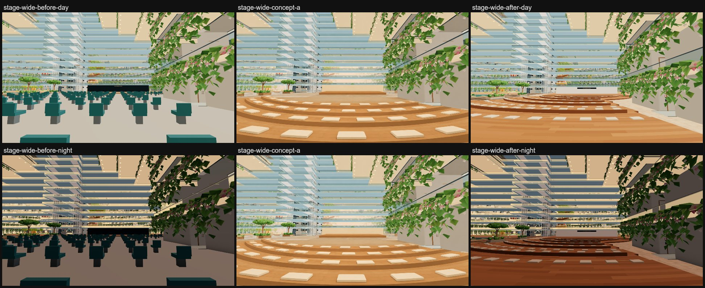
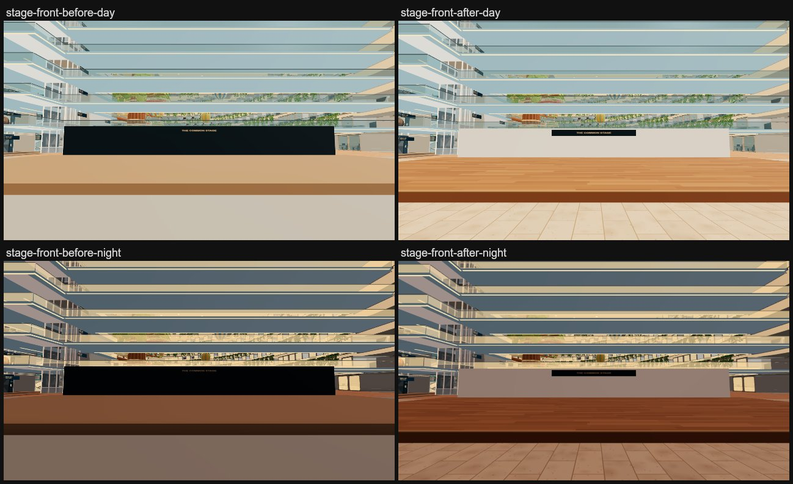
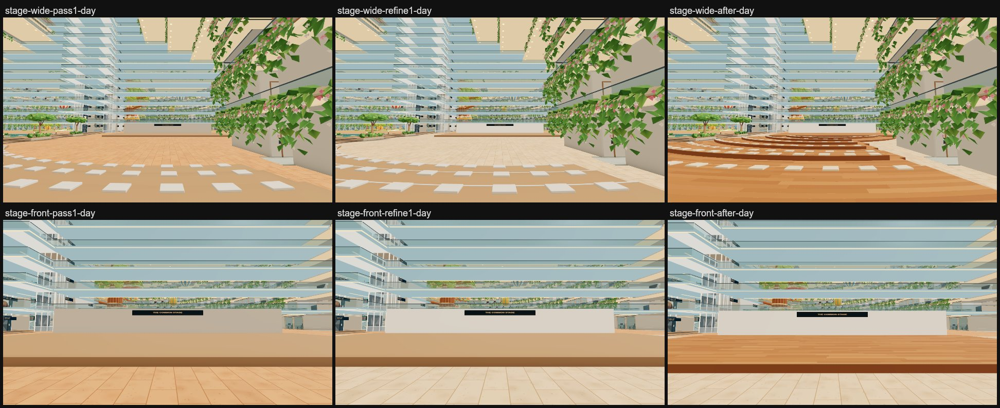

# G5 Common stage: amphitheatre (concept stage-a)

The stage's 145 teal theatre chairs on a flat grey floor become curved terraces of warm, honey-orange timber with 127
cream cushions, stepping down from the back of the zone to a short apron in front of the stage. The stage keeps its
14 x 32 m deck (now laid with the same boards) and its THE COMMON STAGE sign; the navy backdrop behind it becomes a cream
stone wall. The apron is pale travertine.

*Before is main a7b127ff, after is 4683b34e (refine 2); all are r187 builds (three 0.187.0) in `leo-floor-before`,
captured with `scripts/capture-atrium-areas.mjs --only=stage-wide,stage-front --query=time=day|night` (the before set was
taken by atrium-lake-food from its a7b127ff build). The concept was painted over an older, brighter capture, so compare
layout and hue, not brightness.*

## Passes

1. **First build (fcecd2e0):** four 0.24 m oak tiers at radii 24.4–35.5 m, one cushion row each (62 seats), a big plaza
   in front.
2. **Refine 1 (e0671d2b):** pale step nosings, a lit cream wall, pale plaza paving. From stage-wide it still read as a
   thin band of steps behind an empty plaza.
3. **Refine 2 (4683b34e, Jay):** the terraces now run from the back row to a normal 4.5 m apron. They span most of the
   zone and fill the stage-wide frame down to the stage, as in the concept. The timber is warmer and more orange, with no
   new draw.

## What changed

| File | Change |
| --- | --- |
| `src/v2/atrium-stage.js` (new) | The terrace plan (`stageBands`, `stageTiers`, `stageSeats`), the colliders and wall (`addAtriumStage`, `stageGeometry`), and the visible timber, nosings, cushions and stage deck (`addStageDecor`) |
| `src/v2/phase6-programme.js` | The stage platform/backdrop line and the chair grid become one `addAtriumStage({parts,rests,y})` call; the sign line is unchanged |
| `src/v2/phase4-fitout.js` (+ `.authoring.js`) | `stageGeometry(b)` is tried after `reflectionGeometry(b)` for parts with a `stageShape` |
| `src/v2/atrium-gardens.js` | One `addStageDecor(out,layout)` call (after `addFallingWater`) adds the stage's timber to the garden mesh |
| `src/v2/atrium-architecture.js` (+ `.authoring.js`) | One line beside the terrace-guard hook hides the stage's collider furnishings (`P4_p6_stage_(tiers\|cushions_N\|platform)`) |
| `src/v2/standing.js` | The treads and bench tops are planned floors, like the Forum terraces |
| `src/plan/atrium-v2.js` | The stage zone's floor colour: grey `0xb6b8b0` becomes pale travertine `0xf2d7b4` |
| `src/v2/atrium-surfaces.js` (+ `.authoring.js`) | The stage zone takes the travertine paver texture (`paved`), in its own colour |

## How the terraces work

- **Plan.** The terraces are annular bands about the stage's front middle (x 108, z 30). There are four tiers, each
  0.24 m up:

  | Tier | Radii (m) | Seat rows |
  | --- | --- | --- |
  | 1 | 6.5–26.6 | its step, then benches at 10.8, 15.1, 19.4 and 23.4 m |
  | 2 | 26.6–32.6 | its step, then a bench at 29.6 m |
  | 3 | 32.6–36.6 | its step |
  | 4 | 36.6–41.5 | its step; the 0.96 m top promenade, where the stage-wide viewpoint (x 68) stands, as in the concept |

  The deep treads carry **0.65 m deep, 0.3 m high timber benches**, so the nine seat rows step all the way down to the
  stage. Tier 1's front is at x 101.5, which leaves a **4.5 m apron** to the stage deck (x 106).
- **Reach.** Each band reaches round as far as the zone allows. The inner bands wrap round the stage, reaching z 8.5 to
  44.3. The outer bands stop at z 35 by the room recess (x 71–89, z ≥ 37.6).
- **Clearances.** Everything stays inside G5: the terraces cover x 66.5–104.6 and z 8.5–44.3, and the stage is unchanged
  at x 106–120. The terraces keep at least 2.59 m from the atrium outline (phase6-sanity wants 2.4 m) and stay under
  1.1 m, far below the Deck 7 slab. The boulevard, the x −79 and x 2 cross routes and the food stalls are untouched.
- **Walking.** Every rise is under the walker's 0.4 m step (`BODY.step`, `src/walk/collision.js`): 0.24 m per tier and
  0.3 m onto a bench. So every tread and bench is walked onto from the one in front, anywhere along the arc, with no
  aisles or ramps.
- **No rails needed.** The top is 0.96 m, under the 1 m drop that `scripts/v2-walk.mjs` allows without a guard, so the
  back edge and the band ends need no rail. Each band and bench is a closed solid from the deck up, so the walker can't get
  inside one.
- **Collision.** The tiers (one solid of 5,264 triangles), the nine cushion rows (one part per row, 1,524 triangles) and
  the stage platform box stay phase 4 furnishings. `addPhase4Colliders` takes their real triangles, and `groundMesh`
  counts them as ground (the name has `stage`).
  - `atrium-architecture.js` hides them as `phase6ArchitectureSource`, as it does for the terrace guards, so they
    collide but never draw. Culling, batching and phone-furnishing all skip them.
  - The cushion colliders are split by row so each row's box keeps 2.4 m off the outline.
  - The back wall stays visual only (`noCollide`), as the old backdrop was.
- **Look.** The visible terraces are in the garden mesh (`P6_atrium_gardens`, already one vertex-coloured, flat-shaded
  draw), in 128 pieces and 36,876 triangles:
  - honey-orange timber boards (`0xad7441`–`0xc28a55`), laid in concentric 0.3 m strips of 2.4–4.4 m boards;
  - darker risers, ends and bench fronts (`0x9c6538`);
  - pale nosings (`0xdcae78`) on every step, bench and the stage front;
  - rounded cream cushions (`0xf1e1c4`);
  - the stage deck in the same boards.

  The wall's face faces aft, away from the atrium's sun, where cream renders tan, so its normals are tilted towards the
  light (as `atrium-architecture.js` does for the lift tower).
- **Why the garden mesh and not oak.** The shared `oak` material has no vertex colours. Turning them on would need a
  colour attribute on every oak furnishing, or they render black. A warmer timber in oak therefore meant a new material
  and a new draw. The garden mesh already draws the atrium's floor decor in vertex colour, so the warm timber costs no draw
  there.

## How the seats work

The cushions re-anchor the existing seat system; nothing new was invented. Each cushion is a rest spot in the phase 6
programme's `rests`, exactly like the chairs it replaces:

- They are `kind:'sit'`, `phase4`/`phase6` and `instanced`, with ids `p6-stage-tier-<1..4>-seat-<n>`.
- `point`/`height` are the cushion's top (the tread or bench + 0.08 m, at most 1.04 m), and `facing` points at the
  centre (towards the stage).
- There is one row per step and per bench, 0.36 m behind its nosing and about 1.6 m apart. Cushion edges keep 1 m in from
  the band ends on steps and 1.5 m on benches (0.5 m in from the bench ends): tier 1 has 68 seats, tier 2 has 30, tier 3 has 15 and tier 4 has 14, so 127 in all.
- A walker stands on the tread in front of a cushion and sits facing the stage. phase6-local finds that approach for all
  669 phase 6 seats (it needs `plannedStanding`, hence `standing.js`), and the prepared-walk audit finds a collider under
  every seat at its height.
- No other code referred to the old `p6-atrium6-stage-seat-*` ids.

Seats in the zone go from 145 chairs to 127 cushions (phase 6 total 687 → 669; phase6-sanity wants more than 500).

## Cost

From the walk's `?fps=1` readout at 1600 x 900 (`stats.json` beside each capture set):

| View | Before (a7b127ff) | Refine 1 (e0671d2b) | Refine 2 (4683b34e) |
| --- | --- | --- | --- |
| stage-front, day / night | 438 draws, 7.79M tris | 438, 7.80M | 438, 7.83M |
| stage-wide, day | 474 draws, 8.29M tris | 537, 9.57M | 537, 9.60M |
| stage-wide, night | 475 draws, 8.29M tris | 538, 9.57M | 538, 9.60M |
| deck-level control, 2.2 m behind stage-wide (x 65.8) | — | 476, 8.32M | 476, 8.35M |

- **No new draws from the stage.** The warm timber, nosings, cushions and stage deck are merged into the existing garden
  draw, and the colliders are hidden. The wall (12 triangles) is a cream furnishing in the existing batch. Refine 2 draws
  exactly what refine 1 did in every view.
- **stage-wide costs more only because the walker stands higher.** The viewpoint lands on the 0.96 m top tier. From that
  eye height more of the ship is in view (upper balconies, cabins through glass): +63 draws and +1.3M triangles. From the
  deck just behind the terraces, the same view costs 476 draws, within 2 of before.
- **Geometry.** The garden mesh grows by 36,876 triangles, against 5,220 for the 145 chairs it replaces. The colliders
  (6,800 triangles) are never drawn.

## Checks and the PVS key

All on the r187 build of 4683b34e in `leo-floor-before` (exit 0 each):

| Check | Result |
| --- | --- |
| `npm run check:walk` | PASS: no unguarded drops over 1 m (`guardGaps` empty), 0 void falls; seats and beds 35,376/35,376 usable, the stage's 127/127 |
| `node scripts/check-phase6-v2.mjs` | PASS: all 12 tasks (sanity with 669 seats, local seat fit 669/669, contract, floor/canopy/fog/visibility/directory/service-deck/live-glass fixtures, prepared audit incl. the atrium void, sky tip) |
| `node scripts/check-prepared-runtime-migration.mjs` | PASS |
| `npm run check:atrium-time` | PASS, 12 checks |
| `node scripts/check-atrium-void-fixtures-v2.mjs` | PASS |
| `node scripts/check-prepared-walk-v2.mjs` | PASS |
| `node scripts/check-void-guards-v2.mjs` | PASS |
| `node scripts/check-lobby-tile-v2.mjs` | PASS |
| `node scripts/check-main-features-v2.mjs` | PASS |

Refine 1 (e0671d2b) also passed all nine, with 62/62 stage seats.

**Atrium PVS key** (the colliders changed): `4.63d7c93282b3f79b647143e90093b6df.aaba3802c109794758a3fffa000069ed.6afd3900849f657047053acc00000001`
→ `4.63d7c93282b3f79b647143e90093b6df.a8a438c4b9b108b0fd782f8700006844.6afd3900849f657047053acc00000001`. None is baked
for either key today, so nothing goes stale. A bake for the new key would follow the usual `scripts/walk-atrium-pvs.mjs`
route.

## Left as it is / follow-ups

- The back wall stays `noCollide`, as the navy backdrop was; walking off the back of the stage passes through it.
- `scripts/check-source-fold.mjs` (not in the required list) already fails on main, on `server/live-core.mjs`, so the
  switchover pins were not re-pinned here.
- **Merge notes:**
  - `atrium-surfaces(.authoring).js` changes one condition in the long zone-floor line that the lobby and food jobs may
    also touch.
  - `atrium-architecture(.authoring).js` adds one line right after the terrace-guard hook. atrium-lobby-park adds its
    welcome-desk line near there too.
  - `atrium-gardens.js` adds an import and one line after `const falling=…`.
  - `phase6-programme.js` changes only the stage lines, and `atrium-v2.js` only the stage zone's colour.
