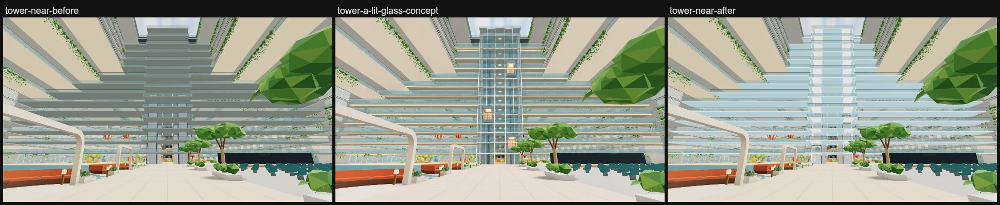
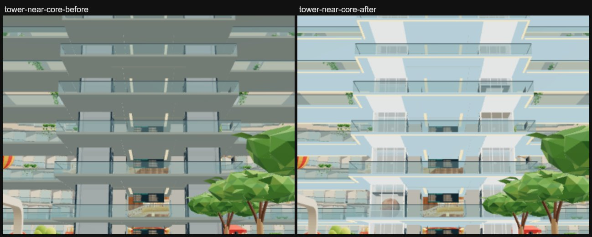
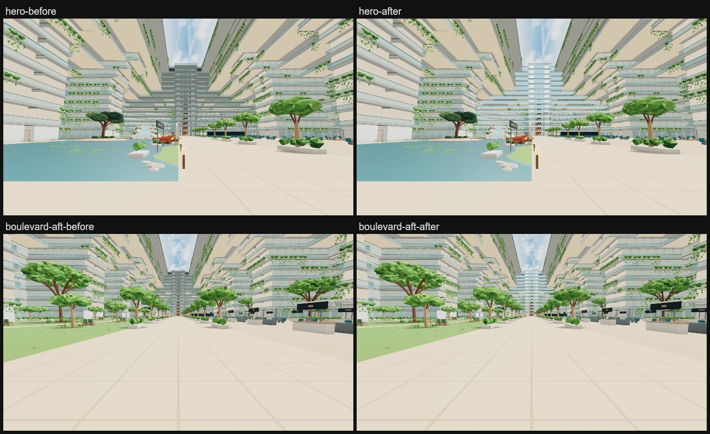

# S3b lift tower: concept A, "lit glass"

Jay's pick for the Deck 6 forward lift tower ([`docs/atrium-areas.md`](../../atrium-areas.md)).

*Before is the live site (`baseline-639f7393`); its tower is the same as base f8af5b3a's. After is a local build of
this branch (8bca23a4, refine pass 3), captured with `scripts/capture-atrium-areas.mjs`. Both render with three 0.187.0. Local builds
that bundle three 0.185.1 (a stale `node_modules`) render the atrium much darker and warmer than live, so don't judge
colour on them.*

## What changed

All of this is in the facade's merged copy of the tower (`atrium-architecture.js`) and the walk's lift cars. The walked
tops keep their finish.

- **Glass-blue bands with slim edges.** The bridge and landing undersides and their fascias are glass-blue (`80b2cc`),
  so a slab's edge recedes and reads as the warm line under it (vertex colours; `TOWER_SLAB_FACES`,
  `src/v2/model.js`). Both are shaded as if they faced up. Shaded truly, a face looking down takes the hemisphere's
  ground colour and the lower environment, so the concept's pale glass-blue reads steel grey.
- **One glass column through the landings.** A pale lane (`e6f3f8`) runs under each landing above Deck 6, from its aft
  edge to each forward shaft and as wide as the shaft (`towerShaftLanes`, `src/v2/model.js`). Stacked, the lanes carry
  the shafts down through the landings as one light column. A warm light line runs the full height of both aft corners
  of each forward shaft, and a small warm light sits in the middle bay of each shaft's fore face at every storey from
  Deck 6 up (`towerFrame`, `src/transit.js`).
- **A warm golden line under every level.** A light strip (20 x 10 cm, hanging 8 cm below the slab) runs under both
  long edges of every bridge above Deck 6, over the open atrium. It also runs along each landing's aft edge and its
  returns to the bridges, so the line crosses the tower unbroken (`towerBridgeLights`, `src/v2/model.js`). It shares the
  lift lobbies' light material, now emissive `ffc66e` at 1.5, so the lobby lights warm too.
- **Bright glass shafts in a white frame.** The forward shafts' glass is clear and pale blue, where the walk used to
  frost every shaft (`src/walk/main.js`). Each glazed face gets two white mullions, so three bays across like the
  concept, plus transoms at every floor and a metre above it. The guide columns turn white (`towerFrame`,
  `src/transit.js`). The lowest metre of each storey stays frosted, so an empty shaft still reads as a wall at a
  walker's feet. The glass, frit and frame are shaded as if they faced up too (`towerLit`): their faces looking aft at
  the atrium sit in the sun's shade and read grey.
- **Lit cabins.** The forward cars' walls are warm-lit, and their aft wall is glass, so the atrium sees into them and
  the Mars art faces out (`src/walk/lift-ride.js` and twins). The forward cars now start at Deck 7 (port) and Deck 10
  (starboard) instead of Deck 15 (`parked`, `src/walk/lifts.js`). `parked` only sets where a car starts, on the page
  alone or on the server at start. A car stays wherever it last stopped, so ride logic and how calls are served are
  unchanged.
- **Unchanged:**
  - The bridges' glass balustrades. They are the walk's shared void guards, used ship-wide.
  - Bridge and landing geometry and colliders, the tower footprint and height.
  - The aft lift core's geometry. Its lobby lights share the strip material, so they warm too.

**Where it differs from the concept:**
- The concept draws one slim glass prism with paper-thin bridges. The real landings (24 m deep) and bridges stay, as
  asked, so from the floor each landing's underside hides most of the shaft above it. The framed glass shafts read on
  the lower decks and from hero, where the tower now reads as a glass column.
- The cabins are in view but don't glow like the concept's.
  - **What shows.** The port car at Deck 7 shows from tower-near and hero. From tower-near, the starboard car at Deck 10
    is hidden behind its own landing except its top 0.7 m; it shows from hero. Each landing reaches 7.6 m aft of its
    shaft, so from the floor only cabins on the lowest decks show whole.
  - **Why they don't glow.** From the atrium you see through the glass aft wall to the Mars art on the fore wall, and
    the warm side walls are edge-on. The warm panels tone-map to near white. A tuning run with saturated amber panels
    (`e0a868`, emissive `ff9a40`) made no visible difference from the floor.
  - **What it would take.** A glowing cabin needs a change to the cars, not to where they park: a warm lit fore wall in
    place of the Mars art, or a lit frame round the car. Riders would see either, so neither is done here.
- The concept's warm lines also run along every balcony edge. Those belong to the balcony glow (atrium-light), not here.

## Cost and safety

| View | Draws before -> after | Triangles before -> after |
| --- | --- | --- |
| tower-near | 526 -> 526 | 10,908,530 -> 10,914,914 |
| hero | 558 -> 558 | 10,760,649 -> 10,767,033 |
| boulevard-aft | 695 -> 695 | 10,813,357 -> 10,819,741 |

These are the main pass at each view's pose, measured with `renderer.info` on the review walk of local builds of base
f8af5b3a and this branch ([`metrics-before.json`](metrics-before.json), [`metrics-after.json`](metrics-after.json)).
The tower copy stays at 21 draws. Its triangles grow from 97,398 to 103,782 (+6,384):

| Change | Triangles |
| --- | --- |
| Shaft frame (mullions and transoms) | +3,024 |
| Frosted frit bands | +1,440 |
| Light strips (bridges, landing edges, returns) | +1,176 |
| Shaft light lines and storey lights (pass 3) | +408 |
| Shaft lanes under the landings (pass 3) | +336 |

- **No new draws.** Every addition joins a bucket the tower copy already draws:
  - the frame joins the guide columns;
  - the frit joins the frosted shaft glass;
  - the clear shaft glass joins the aft back glass;
  - the strips and the shaft light lines join the lift lobbies' lights;
  - the shaft lanes join the landings;
  - the fascia, underside and lane tones are vertex colours and normals only.

  The cars only swap materials and start decks.
- **Collision is unchanged.** Every addition is `noCollide`. The atrium PVS key is unchanged (`4.1485ebc6…`, the same
  as base), so no re-bake is needed.
- **Distant and phone copies stay Basic.** They take the same vertex colours, so the undersides are glass-blue there
  too. Normals don't affect Basic materials.
- **Void.** Everything added sits inside the tower, landing and bridge footprints; nothing new crosses the void above
  Deck 16.

## Checks (on the after build, 8bca23a4, three 0.187.0)

| Check | Result |
| --- | --- |
| `npm run check:walk` | PASS (lift stops 104/104) |
| `scripts/check-phase6-v2.mjs` | PASS (atrium void audit PASS, distant copy PASS) |
| `scripts/check-prepared-walk-v2.mjs` | PASS (prepared clearance, guard support, finishes) |
| `scripts/check-atrium-void-fixtures-v2.mjs` | PASS |
| `scripts/check-void-guards-v2.mjs` | PASS |
| `scripts/check-main-features-v2.mjs` | PASS |
| `scripts/check-lobby-tile-v2.mjs` | PASS |
