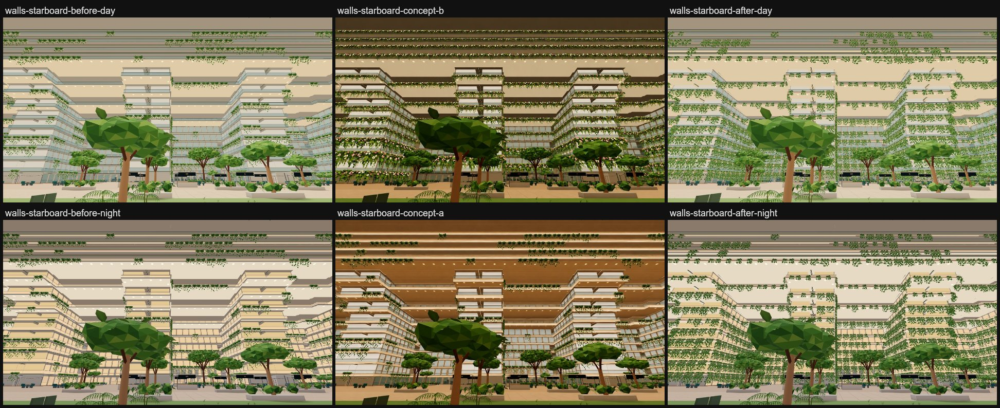
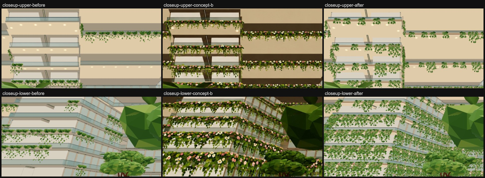
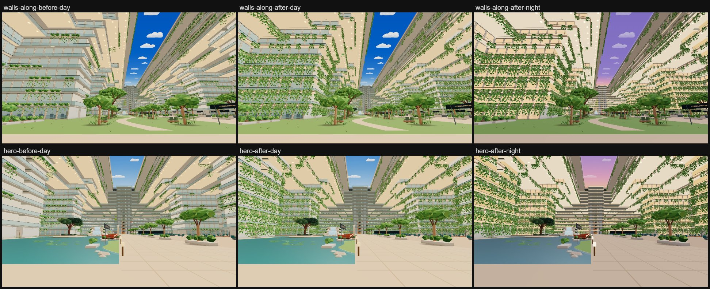

# S2 balcony walls: garden terraces (concept B) with cream fascias (concept A)

The slab edges of Decks 7–16 carry a planter strip, broken by gaps, with trailing greenery and small white and
soft-pink flowers (concept B), on cream limestone fascias with a slim warm-oak top band and a thin bronze line (concept A's
fascias). The balcony undersides stay cream; balustrades and geometry are unchanged.

*Before is a local r187 build (three 0.187.0) of 42113d02 (day/night light + sky A); after is the same base plus this
change at the refine pass (09a4cacb), built in the same folder. The planting was then thinned (b6cb5fdc, below); its
captures come from the combined atrium build. All captures are `scripts/capture-atrium-areas.mjs
--only=walls-starboard,walls-along,hero --query=time=day|night`. The concepts were painted over older, darker
captures, so compare hue and pattern, not brightness.*

## What changed (`src/v2/atrium-gardens.js`)

- **Planter strip, Decks 7–16:** each run of the slab edge is cut into equal slots of about 3.6 m, one trough per slot,
  stretched to fill its run so neighbours abut. On curves, short runs are gathered into chords first. Clustered gaps
  (from smooth noise along the edge) leave about 30 % of the slots bare on Deck 7 and 50 % from Deck 12, so the cream
  fascia shows between planted runs; the strip also stops where the tower, its bridges or a dining apron meet the
  edge. Each trough carries a curtain of large leaves (two rows, about 0.9 m deep) and vines trailing about 1–2 m,
  with white and pink blossom cards (two crossed cards, four triangles) hung in front of the curtain, where the floor
  sees them.
- **Lighter higher up:** three variants (lush, medium, light; the light one gathers its foliage at one end of the
  trough). The lush share falls from about 90 % on Deck 7 to none from Deck 12, and the light share rises to about
  60 % by Deck 12. Variants come in clustered runs from smooth noise along the edge, with a random mirror and a trail
  length per slot, so the upper decks don't read as uniform stripes. Decks 17–20 keep their irregular runs, on the
  new templates.
- **Fascias, Decks 7–16:** they follow the true edge (simplified to 1.5 cm), 3 cm outside the slab, from 0.40 m below
  the floor up to it. The cream limestone is drawn with the soffit (`V2_atrium_soffit`), so it follows atrium-light's
  day/night lerp. The oak band and the bronze line join the static garden draw. They stop at the same tower, bridge
  and apron mouths.
- **Walkway ceilings, Decks 7–16:** the grey bands seen over the guards were the walkway ceilings (the undersides of
  the slab and the facade terrace plate above). A cream sheet in the soffit material now runs just under them, from
  each edge up to 3.5 m inboard (sampled every 0.75 m), stopping at the voids above and below, slab holes and rooms,
  so it shows only where the bare underside did (`walkwayCeilings`).

## Rules kept

- **Void:** every new piece above Deck 16 is a `P6_hanging_garden_*` face within 1.2 m of an edge and no more than
  0.75 m above its deck. Fascias stay at or below their deck's floor. A node run of `auditAtriumVoid` on the gardens
  layer passes: 85,958 faces, 0 violations.
- **Batching:** no new meshes. The planting is still the three instanced `P6_hanging_garden_*` draws (distant copy:
  one silhouette template, Basic). The fascias and walkway ceilings join `P6_atrium_soffits` and `P6_atrium_gardens`. All of these are
  `gardenDecor`, so phones drop them from the distant layer.
- **No collider change:** everything is `noCollide`, so the atrium PVS key is unchanged. `atrium-gardens.js` has no
  pin rows, so nothing to re-pin.

## Cost

| View | Draws before → after | Triangles before → after |
| --- | --- | --- |
| hero | 558 → 558 | 10,760,649 → 11,215,125 |
| walls-starboard | 613 → 613 | 11,067,498 → 11,521,974 |
| walls-along | 812 → 812 | 10,899,351 → 11,353,827 |

Main-pass draws and triangles from the debug review walk (`scripts/launch-a-measure.mjs`): [`stats-before.json`](stats-before.json),
[`stats-after.json`](stats-after.json). The +454,476 triangles (+4.2 %) are the same in every view because the facade
layer draws whole. Those are the refine pass; the thinned planting (b6cb5fdc) is 601,408 near triangles lighter, so
each view should come to about 146,932 triangles *below* before (node counts; the combined build confirms them).

| Planting | Before | Refine (09a4cacb) | Thinned (b6cb5fdc) |
| --- | --- | --- | --- |
| Instances | 1,267 | 3,810 | 2,462 |
| Triangles per variant | 576 / 600 / 656 | 400 / 248 / 138 | 356 / 204 / 136 |
| Near triangles | 775,048 | 1,182,596 | 581,188 |
| Distant-copy triangles | 141,904 | 441,960 | 285,592 |
| Fascias | – | 11.9 km, 13,632 triangles | same |
| Walkway ceilings | – | 33,296 triangles | same |

Void audit of the gardens layer after thinning (node): PASS, 68,170 faces, 0 violations.
