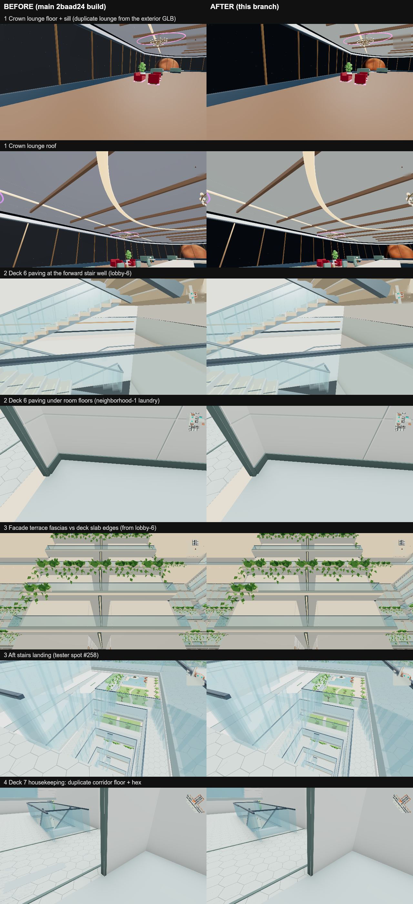

# Coplanar z-fight hotspots (gap 0)

This fixes the four true coplanar hotspots from the ship-wide probe in PR #404. The walk uses a logarithmic depth buffer,
so each fix moves real geometry instead of relying on `polygonOffset`.

*Left: main build. Right: this branch. Same camera, fresh browser profiles, shot back to back.*

| # | Where | Cause | Fix |
|---|-------|-------|-----|
| 1 | Crown lounge / Crown TV | The refined exterior GLB carries its own copy of the whole crown lounge (`build-exterior-finish.mjs`) next to the one the interior builds (`aft.js`). Every crown surface drew twice, 0–0.2 mm apart. | `prepareExteriorForWalking` (`world*.js`) drops the GLB copy right after the finished-skin authority is captured, as the v1 assembly already does. |
| 2a | Lobby 5/6 forward stair well | The Deck 6 paving's stair-hole sides lie in the inner faces of the opaque stair walls. | `finishAtriumFloor` lines those edges with the opaque `Stair_outer_wall`/`Stair_end_wall` footprints, using the same `removeLinedSlabSides` used for cabins. |
| 2b | Deck 6 rooms (neighborhood 1, housekeeping) | The paving is drawn 6 mm proud (`separateAtriumPaving`), exactly the height of the Deck 6 room floors. | Paving top triangles under convex Deck 6 rooms are split along the room outline and drop back to deck level, buried in the room floor (`atrium-architecture*.js`). |
| 3 | Facade terraces (lobby 6, aft stairs, …) | The terrace plates repeated each deck slab's edges, so their fascias shared planes with the slab fascias. | The plates sit 6 mm inside the slabs: the outline shrinks and the masks grow, with mitred corners (`facade*.js`). |
| 4 | Deck 7 housekeeping (and other door approaches on Decks 3+) | 2,291 corridor segments (mostly door approaches) were laid on top of an earlier collinear corridor at least as wide. That doubled the floor and its hex finish. | Only the uncovered stretch is laid. The other 30,703 strips are byte-identical, and an offline coverage test reported 0 misses (`corridor-floor-union.js`). |

## Offline probe (prepared walk)

The in-page probe from PR #404 can't measure current main. It matched prepared ranges by vertex index, which gave
wrong names. It also gets no hits on the `V2_low_deck_merged_*` meshes the walk now draws. So this probe runs offline
against `output/leo-interior-v02/prepared-walk`. At each hotspot it casts a 15×15 grid of rays over a 1 m patch along
the surface normal, through every drawn band and facade mesh. It counts rays whose two nearest hits are different parts
within 1 mm of each other.

| Hotspot | at | before | after |
|---------|----|-------:|------:|
| 1 crown floor | -232, 120.3, -10 | 225 | 0 |
| 1 crown roof | -234.36, 125.5, -4.25 | 225 | 0 |
| 1 crown sill | -226.09, 120.55, -13.76 | 173 | 15 ¹ |
| 2 laundry floor | -142.19, -19.69, -4.13 | 120 | 0 |
| 2 Deck 6 housekeeping floor | -111.93, -19.69, -63.35 | 210 | 0 |
| 3 terrace fascia, lobby 6 | 79.6, -11.81, 36.58 | 45 | 0 |
| 3 terrace fascia, aft stairs | -134.91, 28.12, -16 | 35 | 0 |
| 4 Deck 7 housekeeping −z | 79.52, -15.69, -62.18 | 135 | 0 ² |
| 4 Deck 7 housekeeping +z | 80.37, -15.69, 64.17 | 165 | 0 ² |

At the lobby 5/6 stair well, the prepared triangles listed at (145.2, -19.82, -7.8) and (145.8, -19.76, 4.34) no
longer include `P6_atrium_floor_actual`. What remains in those planes is the stair wall itself plus its
`P6_tower_architecture` stand-in, which is hidden while the full atrium bands draw.

¹ This is the crown floor's edge against its own `Crown_white_underfloor_rim`. It was there before as well and is not
the duplicate.
² About 2 mm remains between the corridor floor and its hex finish. That is the intended layering.

## Not fixed here

Deck 9 housekeeping (28.1, -7.69, -68.72): the curved `d9-ring-49` corridor (0.5 m chords) and the straight
`d9-housekeeping--104--1-door-approach` route overlap about 0.3 m apart. They are nearly parallel but not collinear,
so the collinear rule above leaves them alone. A fix would mean subtracting general strip overlaps (as Decks 1–2 do)
across Decks 3+.

## Follow-ups

**Crown sill (fixed).** `Crown_white_underfloor_rim` was laid on the same outline as `Crown_observation_floor`, so the two
shared side planes. The rim outline now grows 6 mm outward (`growRing` in `fin-crown.js`, mitred, either winding). The floor
is unchanged because it's a skin-clearance authority. Offline probe at the sill: 15 → 0.

**Stair walls vs `P6_tower_architecture` (left as is).** At lobby 5/6, 60 rays per wall still pair the opaque stair walls
with the tower stand-in. That copy is hidden while the full atrium bands draw, and below the atrium floor it is the only
geometry by design (#258/#267/#272). Changing it means changing the atrium visibility policy, not the walls.

**Deck 9 / Decks 3+ corridors (fixed).** The pairs at Deck 9 housekeeping (28.1, -7.69, -68.72) and Deck 3 launch
street weren't duplicate strips. The walk bake's `coplanarNudges` (`src/walk/render-bake.js`) lifts each coplanar face 2 mm
(`NUDGE`) per overlap layer, and it judges overlap by axis-aligned bounds, so adjacent rotated strips stacked too. 2 mm is
also the hex finish's offset, so a lifted corridor top landed exactly in a neighbour's hex sheet. Corridor tops on Deck 9
sat 8 to 20 mm above the deck. Now `finish-kit` marks each floor it lays a hex sheet over (`userData.v2HexBase`), and the
nudge never lifts those floors' top faces. Anything left flush with such a top is hidden under the same hex sheet. Every
corridor top in the prepared walk now sits at deck + 8 mm (88,818 m²). Offline probe: Deck 9 225 → 0, Deck 3 98 → 0, and
Deck 7 N02, Deck 16 and Deck 7 housekeeping stay at 0 under 1 mm. Triangle count is unchanged.
